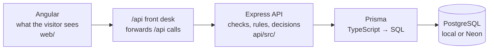

# Portfolio Project Map

Every layer and every file, with **one line** on what it does and **why** it exists. No code.
Read it top to bottom once, then use it to find your way. *(State: 31 Oct 2026.)*

**Legend:** 🆕 added for the Blog (milestones 1–3, done) · ⏸️ step 4a, written but parked (not committed) · 💻 only used on my laptop

Full details live in [`docs/`](docs/README.md). My questions and answers: [`docs/12-my-questions-faq.md`](docs/12-my-questions-faq.md).

---

## The whole project in one line

Every request travels left to right; the answer comes back right to left.



---

## Why the API is split into four pieces

Each piece has **one job**, for the same reason Angular separates routes, components and services.

| API piece | Its one job | Never does | Angular equivalent |
|---|---|---|---|
| **routes** | "This URL + method → this function" | any logic | `app.routes.ts` |
| **controller** | Talks **HTTP**: reads the request, checks input, picks the status code (200 / 400 / 404) | touch the database | a **component**: deals with the outside world |
| **service** | Talks to the **database**: the actual data work | touch `req` / `res` | an **Angular service** |
| **Prisma** | Turns `prisma.skill.findMany()` into SQL and runs it | decide anything | `HttpClient` |
| **middleware** | Runs before routes for many URLs at once (guard, 404, errors) | feature logic | route guards / interceptors |

**Payoff:** switch databases → only services change. Add a mobile app → controllers change, services stay. Test the rules → no browser needed.

---

## Layer 1 · Frontend: Angular (`web/`)

Shows the page, reacts to clicks, asks the API for data. **Never talks to the database directly.**

### Start-up and the frame
| File | What it does and why |
|---|---|
| `src/index.html` | The first file the browser loads: fonts, favicon, and the empty `<app-root>` Angular fills |
| `src/main.ts` | Starts Angular: boots `App` with the settings from `app.config.ts` |
| `app/app.config.ts` | App-wide tools: the router and `HttpClient` |
| `app/app.routes.ts` 🆕 | Which page for which address: `/` → Home. `/blog` and `/admin` come later |
| `app/app.ts` · `app.html` 🆕 | The frame on every page: header, `<router-outlet>` (the current page goes here), footer |
| `src/styles.scss` | Colours, fonts and shared helpers (`.btn`, scroll animations) used by every component |

### Pages and sections (what you see)
| File | What it does and why |
|---|---|
| `pages/home/` 🆕 | The Home page: lists the sections in order. Projects waits behind `@defer` until you scroll near it |
| `sections/hero` · `impact-strip` · `expertise` | Static content written in the code. No API call |
| `sections/projects` | Project cards and category chips. Data from `GET /api/projects` |
| `sections/experience` · `skills` | Timeline and skill chips. Data from `GET /api/experience` and `/api/skills` |
| `sections/contact` | The form: **sends** a message with `POST /api/contact`. Also the WhatsApp link (no API) |
| `layout/header` · `footer` | Navigation bar and footer, shown on every page |
| `shared/section-heading` | The numbered heading reused by every section |

### Talking to the API
| File | What it does and why |
|---|---|
| `core/api.config.ts` | The API address, written once: `/api` |
| `core/projects` · `experience` · `skills` `.service.ts` | One service per feature. They **read** with `httpResource` (data arrives as a signal) |
| `core/contact.service.ts` | **Sends** the form with `HttpClient.post`: a one-off action, so not `httpResource` |
| `project.ts` · `experience.ts` · `skill.ts` · `contact.ts` | TypeScript shapes of the data the API sends back |
| `environments/*.ts` | `apiBaseUrl: '/api'` for both laptop and live |

### Tests
| File | What it does and why |
|---|---|
| `app.spec.ts` · `pages/home/home.spec.ts` | 3 tests: the app starts, the headline shows, the nav links are right. `npm test` in `web/` |

---

## Layer 2 · The `/api` front desk 🆕 (between web and api)

The browser only ever talks to the **website's address**. Anything starting with `/api` is quietly forwarded to the API.
**Why:** one address makes the login cookie safe (`sameSite`), and CORS stops mattering.

| File | What it does and why |
|---|---|
| `web/proxy.conf.mjs` 💻 | On my computer: `localhost:4200/api/…` → `localhost:3000/api/…`. Explained in comments inside the file |
| `web/vercel.json` | Live: `/api/…` → the API project on Vercel. Every other address → Angular's `index.html` (so `/blog` works). JSON can't hold comments, so it's explained in [`web/vercel.json.md`](web/vercel.json.md) |

---

## Layer 3 · Backend: Express API (`api/src/`)

Receives every request, **never trusts the browser**, applies the rules, decides the answer. The only layer allowed to reach the database.

### Wiring (how a request gets in)
| File | What it does and why |
|---|---|
| `server.ts` 💻 | Starts the server on port 3000. On Vercel it isn't used |
| `app.ts` | The pipeline every request passes, in order: CORS → read JSON body → read cookies → `/api` routes → 404 → 500 |
| `routes.ts` | The switchboard: one line per feature (`/projects`, `/contact`, `/auth`, `/admin` …) |
| `config/env.ts` | Reads the settings (`.env`) in one place; stops at start-up if one is missing |
| `db/prisma.ts` | The one shared database connection every service uses |

#### `server.ts` vs `app.ts`

**A request from Angular never goes through `server.ts`.** `server.ts` runs only **once**, when the API starts. `app.ts` describes what happens to **every** request.

Picture a restaurant:
- **`server.ts` = unlocking the front door at 9 a.m.** It happens once, when you run `npm run dev`. Its whole job is one line: "start listening on port 3000". After that, it does nothing.
- **`app.ts` = what happens to each customer who walks in:** greeted, seated, order taken, food served. That routine repeats for **every** request:
  ```
  CORS check → read JSON body → read cookies → /api routes → (nothing matched → 404) → (crash → 500)
  ```

| API | Angular | Runs |
|---|---|---|
| `server.ts` | `main.ts` (`bootstrapApplication`) | once, at start |
| `app.ts` | `app.config.ts` + `app.routes.ts` | rules applied to every request |

```
Start:    npm run dev → server.ts → takes the app from app.ts → listens on port 3000   ← ONCE
Request:  Angular → port 3000 → app.ts pipeline → routes.ts → controller → service    ← EVERY TIME
```

**Why two files?** The same `app` is used in **three places**, and only one of them needs a port:
1. **Laptop:** `server.ts` opens port 3000 and hands requests to `app`.
2. **Vercel:** doesn't use `server.ts`; it has its own "door" and takes `app` straight from `app.ts` (`export default app`).
3. **Tests:** Supertest sends fake requests straight into `app`, no port needed.

In one file, Vercel and the tests would also try to open port 3000, which they can't and shouldn't.

### Middleware (runs around the routes)
| File | What it does and why |
|---|---|
| `middleware/not-found.ts` | No route matched → 404 JSON |
| `middleware/error-handler.ts` | Something crashed → logs it, sends a safe 500 message (no internal details leak) |
| `middleware/check-origin.ts` 🆕 | Changes to `/auth` and `/admin` must come from my website, else 403 |
| `middleware/require-admin.ts` 🆕 | The guard at the admin door: valid login cookie + admin role, else 401. Admin code never runs without it |

#### Middleware = the server's interceptors and guards

**Middleware is the server's version of interceptors and guards. Some steps run for every request, others only on specific paths, and a couple only when something goes wrong.**

Same idea as an Angular interceptor: each step can look at or change the request, **pass it on** (`next()`, like `next.handle(req)`), or **stop it**. The difference: interceptors run in the **browser** on requests going **out**; middleware runs on the **server** on requests coming **in**.

| Middleware | Registered | Runs for |
|---|---|---|
| `cors()` · `express.json()` · `cookieParser()` | `app.use(...)` at the top of `app.ts` | **every** request, before routing |
| `checkOrigin` | in front of `/auth` and `/admin` in `routes.ts` | only those paths |
| `requireAdmin` | inside `admin.routes.ts` | only `/api/admin/...` (like a `CanActivate` guard) |
| `notFound` · `errorHandler` | at the **end** of `app.ts` | only as a fallback: nothing answered (404) or a crash (500) |

### Features (each one = routes + controller + service)
| Folder | What it does and why |
|---|---|
| `modules/projects` | Read projects: paging, title search, category filter, one by id |
| `modules/experience` · `skills` | Read jobs (newest first) and skill groups with their skills |
| `modules/contact` | Save a message: validate → rate limit → save → email me (`contact.email.ts`, via Resend) |
| `modules/auth` 🆕 | Login (check password, create session, give cookie), `/me` (who am I?), logout |
| `modules/admin` 🆕 | The admin door: puts the guard in front of everything under `/api/admin`. Test route `/check` |
| `modules/admin-posts` ⏸️ | Create, list and open my blog posts (+ a validation file with the field rules) |

#### Inside one feature: routes, controller, service

| File | One-line definition | Angular equivalent |
|---|---|---|
| `*.routes.ts` | **The address book:** which URL + method calls which controller function | `app.routes.ts` |
| `*.controller.ts` | **The receptionist:** reads the request, checks the input, calls the service, and picks the status code for the answer | a **component**: uses the service's methods and deals with the outside world |
| `*.service.ts` | **The worker:** the helper functions that read and write the database through Prisma. Knows nothing about HTTP | an **Angular service**: the reusable data logic the component calls |

Just like a component calls a service's methods, **a controller calls the service's helper functions**. The controller never touches the database; the service never touches `req` or `res`.

**The order the files run in** (example: `GET /api/skills`):
```
app.ts               pipeline: CORS → JSON body → cookies → hands /api/… on
  → routes.ts          switchboard: /skills → skills.routes.ts
  → skills.routes.ts   GET / → controller function listSkillGroups
  → skills.controller.ts   checks input, calls the service
  → skills.service.ts      findSkillGroups() asks Prisma for the groups + skills
  → db/prisma.ts → Postgres   SQL runs, rows come back
  ← service returns data ← controller sends res.status(200).json(...) ← back to Angular
```
Admin features add guards before the routes: `routes.ts` → `checkOrigin` → `admin.routes.ts` → `requireAdmin` → feature routes → controller → service.

### Helpers, scripts and tests
| File | What it does and why |
|---|---|
| `lib/password.ts` 🆕 | Turns a password into a fingerprint (scrypt) and checks one. Passwords are never stored |
| `lib/session-token.ts` 🆕 | Makes the random login token (cookie) and its fingerprint (stored in `sessions`) |
| `lib/slug.ts` ⏸️ | "Signals vs RxJS" → `signals-vs-rxjs`, for post addresses |
| `scripts/create-admin.ts` 🆕 💻 | Creates or resets my admin login. The only way to make a user; there's no sign-up page |
| `tests/` · `vitest.config.ts` | API tests with Vitest + Supertest (fake requests, no real database). `npm test` in `api/` |

---

## Layer 4 · Database: Prisma + PostgreSQL (`api/prisma/`)

Stores everything. **Structure** (tables, columns) changes only through migrations; **data** comes from the seed, visitors, or the admin.

### Files
| File | What it does and why |
|---|---|
| `prisma/schema.prisma` | The plan of every table. Change it first, then migrate |
| `prisma/migrations/` | History of structure changes as SQL files (5 so far). Applied to Neon automatically on deploy |
| `prisma/seed.ts` 💻 | Fills projects, experience and skills with CV data. Never touches messages or blog tables |
| `prisma.config.ts` | Tells the Prisma commands where the database is |
| `generated/prisma/` | Code made by `prisma generate` from the schema. Not committed |

### Tables
| Table | One row is | Filled by |
|---|---|---|
| `projects` | a project card | seed |
| `experiences` | a job | seed |
| `skill_groups` → `skills` | a group, and its skills (one-to-many) | seed |
| `messages` | a contact-form message | visitors |
| `users` 🆕 | someone who can log in (me) | create-admin script |
| `sessions` 🆕 | one logged-in browser (token fingerprint) | login |
| `posts` 🆕 | a blog post (DRAFT or PUBLISHED) | admin (milestone 4) |
| `tags` · `post_tags` 🆕 | a label, and "this post has this tag" (many-to-many) | admin (milestone 4) |

**Two databases, same code:** local PostgreSQL (pgAdmin) on my laptop, and Neon in the cloud for the live site.

---

## Hosting (around everything)

`git push` to GitHub → Vercel rebuilds both projects. Nothing to upload by hand.

| Service | What it does |
|---|---|
| Vercel · **devaangini** | The website (built Angular files). Holds the `/api` front desk and the contact-form firewall rule |
| Vercel · **portfolio** | The API, run as one serverless function. Runs `prisma migrate deploy` on each deploy |
| Neon · **portfolio-db** | The live PostgreSQL database |
| Resend | Emails me when someone sends the contact form |

---

## Two requests, followed through every layer

### Loading the Skills section (reading)
1. **Angular:** the Skills component asks `SkillsService` for the groups.
2. **Angular:** `httpResource` sends `GET /api/skills` to the website's own address.
3. **Front desk:** forwards it to the Express API.
4. **API · `app.ts` → `routes.ts`:** the pipeline runs, then the switchboard picks `skills.routes`.
5. **API · controller:** nothing to check; asks the service for the data.
6. **Service → Prisma → Postgres:** `findMany` becomes SQL on `skill_groups` + `skills`.
7. **Back to Angular:** rows → service → controller sends 200 JSON → the signal updates → the chips appear.

### Logging in, then an admin request 🆕
1. **Browser / Postman:** sends email + password to `POST /api/auth/login`.
2. **API · auth:** fingerprints the password and compares it with `users`. Wrong → 401. Checked **once**.
3. **API → `sessions`:** right → makes a random token and saves only its fingerprint in `sessions`.
4. **API → browser:** sends the token in the `Set-Cookie` **response** header. The browser stores it.
5. **Browser, every later request:** attaches `Cookie: session=…` by itself. Angular does nothing.
6. **API · `require-admin`:** fingerprints the cookie and looks in `sessions`: found + admin → allowed. Otherwise 401.
7. **Logout:** deletes the session row and the cookie.

---

*Keep this file in sync when files are added or their job changes.*
