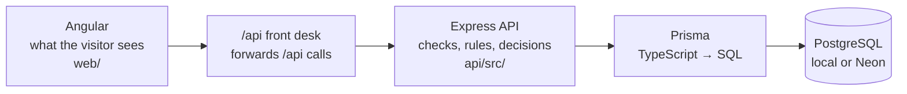

# Portfolio Project Map

Every layer and every file, with **one line** on what it does and **why** it exists. No code.
Read it top to bottom once, then use it to find your way. *(State: 31 Oct 2026.)*

**Legend:** 🆕 added for the Blog (milestones 1–3, done) · 💻 only used on my laptop

Full details live in [`docs/`](docs/README.md). The login flow for interviews: [`docs/13-jwt-login-notes.md`](docs/13-jwt-login-notes.md). Every API + Postman guide: [`docs/14-backend-api-handbook.md`](docs/14-backend-api-handbook.md). My questions and answers: [`docs/12-my-questions-faq.md`](docs/12-my-questions-faq.md).

---

## The whole project in one line

Every request travels left to right; the answer comes back right to left.



---

## Why the API is split into four pieces

Each piece has **one job**, for the same reason Angular separates routes, components and services.

| API piece | Its one job | Never does | Angular equivalent |
|---|---|---|---|
| **routes** | "This URL + method → this function" | any logic | `app.routes.ts` |
| **controller** | Talks **HTTP**: reads the request, checks input, picks the status code (200 / 400 / 404) | touch the database | a **component**: deals with the outside world |
| **service** | Talks to the **database**: the actual data work | touch `req` / `res` | an **Angular service** |
| **Prisma** | Turns `prisma.skill.findMany()` into SQL and runs it | decide anything | `HttpClient` |
| **middleware** | Runs before routes for many URLs at once (guard, 404, errors) | feature logic | route guards / interceptors |

**Payoff:** switch databases → only services change. Add a mobile app → controllers change, services stay. Test the rules → no browser needed.

---

## Layer 1 · Frontend: Angular (`web/`)

Shows the page, reacts to clicks, asks the API for data. **Never talks to the database directly.**

**How the folders are organised (since 9 Nov 2026):** by **feature**, the way the Angular style guide and most company projects do it. Everything one feature needs (component, service, data types) lives together. `core/` holds app-wide things used once, `shared/` reusable pieces. Imports use **path aliases**: `@core/…`, `@shared/…`, `@layouts/…`, `@features/…` (set in `web/tsconfig.json`), instead of `../../../`.

```text
web/src/app/
├── app.ts · app.html · app.config.ts · app.routes.ts · app.spec.ts   the root (app.html = only <router-outlet>)
├── core/        app-wide infrastructure, no UI:  api/ (API address) · auth/ (login state, guard, interceptor)
├── layouts/     page frames, picked by the router: public-layout/ (+ header, footer) · admin-layout/
├── shared/      reusable, no data:     ui/section-heading/ · ui/dialog/ · styles/forms.scss
└── features/    one folder per feature: home/ (+ its sections) · admin/ (lazy) · blog/ (milestone 7)
```
**Where does a new file go?** One feature → `features/<feature>/` (most files). A frame → `layouts/`. Reusable with no data, used by 2+ features → `shared/`. App-wide infrastructure → `core/`. Not sure → start in the feature. Full guide: [`docs/03` → Folder-by-folder](docs/03-frontend-documentation.md#b-folder-by-folder).

### Start-up and the frame
| File | What it does and why |
|---|---|
| `src/index.html` | The first file the browser loads: fonts, favicon, and the empty `<app-root>` Angular fills |
| `src/main.ts` | Starts Angular: boots `App` with the settings from `app.config.ts` |
| `app/app.config.ts` | App-wide tools: the router, and `HttpClient` with the auth interceptor |
| `app/app.routes.ts` 🆕 | Which frame + page for which address: `/` → `PublicLayout` → Home, `/admin/…` → the admin area (**lazy-loaded**, `AdminLayout`). `/blog` comes later |
| `app/app.ts` · `app.html` 🆕 | Only `<router-outlet>`: the router picks the frame (`PublicLayout` or `AdminLayout`) |
| `src/styles.scss` | Colours, fonts and shared helpers (`.btn`, scroll animations) used by every component |

### `core/`: app-wide, used once
| File | What it does and why |
|---|---|
| `core/api/api.config.ts` | The API address, written once: `/api` |
| `core/auth/auth.service.ts` 🆕 | Remembers **who's logged in** (a signal); `login`, `restore` (asks `/me`), `refreshTokens`, `logout`. Never touches tokens: the browser handles the cookies |
| `core/auth/auth.interceptor.ts` 🆕 | On a **401** from an admin call: refresh **once**, repeat the call; if refresh fails → login page |
| `core/auth/admin.guard.ts` 🆕 | `canMatch` guard: `/admin` pages only when logged in, else → `/admin/login?returnUrl=…` |
| `core/auth/auth.model.ts` 🆕 | Types: `AdminUser`, `AuthResponse` |

### `layouts/` 🆕: page frames, picked by the router
| File | What it does and why |
|---|---|
| `layouts/public-layout/` | Skip link + **header** + `<main>` with `<router-outlet>` + **footer**, around every public page (Home, later the Blog). Its spec checks the nav links |
| `layouts/public-layout/header` · `footer` | The site's navigation bar and footer |
| `layouts/admin-layout/` | The admin top bar (Posts · View site · my email · Log out) + `<router-outlet>`. Loaded lazily with `/admin` |

### `shared/`: reusable building blocks
| File | What it does and why |
|---|---|
| `shared/ui/section-heading` | The numbered heading ("01. Title ────") reused by the sections |
| `shared/ui/dialog/` 🆕 | The app's own **"Are you sure?" dialog** (HTML `<dialog>` + `DialogService`). `dialog.confirm({...})` returns a Promise<boolean>; `<app-dialog-host>` sits once in `app.html` and draws it. Used for "Leave without saving?" and "Delete this post?" |
| `shared/styles/forms.scss` 🆕 | Field, input and error styles, pulled in with `@use` (admin login) |

### `features/home/`: the portfolio page
| File | What it does and why |
|---|---|
| `features/home/home.ts` · `.html` | The Home page: lists the sections in order. Projects waits behind `@defer` until you scroll near it |
| `sections/hero` · `impact-strip` · `expertise` | Static content written in the code. No API call |
| `sections/projects/` | Cards + category chips · `projects.service.ts` (**reads** `GET /api/projects` with `httpResource`) · `project.model.ts` (types) |
| `sections/experience/` | Timeline · `experience.service.ts` (`GET /api/experience`) · `experience.model.ts` |
| `sections/skills/` | Skill chips · `skills.service.ts` (`GET /api/skills`) · `skill.model.ts` |
| `sections/contact/` | The form · `contact.service.ts` (**sends** `POST /api/contact` with `HttpClient.post`: a one-off action, so not `httpResource`) · `contact.model.ts` · WhatsApp link (no API) |
| `environments/*.ts` (in `src/`) | `apiBaseUrl: '/api'` for both laptop and live |

### `features/admin/` 🆕: my admin area (lazy-loaded)
| File | What it does and why |
|---|---|
| `admin.routes.ts` | The admin pages, downloaded only when `/admin` opens: `login`, and the rest (inside `AdminLayout`) behind `adminGuard` |
| `login-page/` | Email + password form; shows the API's messages; returns to the wanted `/admin/…` page |
| `posts-page/` | Placeholder for now; the posts table comes in step 6b |

### Tests
| File | What it does and why |
|---|---|
| `app.spec.ts` · `layouts/public-layout/public-layout.spec.ts` · `features/home/home.spec.ts` | 3 tests: the app starts, the nav links are right, the headline shows. `npm test` in `web/` |

---

## Layer 2 · The `/api` front desk 🆕 (between web and api)

The browser only ever talks to the **website's address**. Anything starting with `/api` is quietly forwarded to the API.
**Why:** one address makes the login cookie safe (`sameSite`), and CORS stops mattering.

| File | What it does and why |
|---|---|
| `web/proxy.conf.mjs` 💻 | On my computer: `localhost:4200/api/…` → `localhost:3000/api/…`. Explained in comments inside the file |
| `web/vercel.json` | Live: `/api/…` → the API project on Vercel. Every other address → Angular's `index.html` (so `/blog` works). JSON can't hold comments, so it's explained in [`web/vercel.json.md`](web/vercel.json.md) |

---

## Layer 3 · Backend: Express API (`api/src/`)

Receives every request, **never trusts the browser**, applies the rules, decides the answer. The only layer allowed to reach the database.

### Wiring (how a request gets in)
| File | What it does and why |
|---|---|
| `server.ts` 💻 | Starts the server on port 3000. On Vercel it isn't used |
| `app.ts` | The pipeline every request passes, in order: CORS → read JSON body → read cookies → `/api` routes → 404 → 500 |
| `routes.ts` | The switchboard: one line per feature (`/projects`, `/contact`, `/auth`, `/admin` …) |
| `config/env.ts` | Reads the settings (`.env`) in one place; stops at start-up if one is missing |
| `db/prisma.ts` | The one shared database connection every service uses |

#### `server.ts` vs `app.ts`

**A request from Angular never goes through `server.ts`.** `server.ts` runs only **once**, when the API starts. `app.ts` describes what happens to **every** request.

Picture a restaurant:
- **`server.ts` = unlocking the front door at 9 a.m.** It happens once, when you run `npm run dev`. Its whole job is one line: "start listening on port 3000". After that, it does nothing.
- **`app.ts` = what happens to each customer who walks in:** greeted, seated, order taken, food served. That routine repeats for **every** request:
  ```
  CORS check → read JSON body → read cookies → /api routes → (nothing matched → 404) → (crash → 500)
  ```

| API | Angular | Runs |
|---|---|---|
| `server.ts` | `main.ts` (`bootstrapApplication`) | once, at start |
| `app.ts` | `app.config.ts` + `app.routes.ts` | rules applied to every request |

```
Start:    npm run dev → server.ts → takes the app from app.ts → listens on port 3000   ← ONCE
Request:  Angular → port 3000 → app.ts pipeline → routes.ts → controller → service    ← EVERY TIME
```

**Why two files?** The same `app` is used in **three places**, and only one of them needs a port:
1. **Laptop:** `server.ts` opens port 3000 and hands requests to `app`.
2. **Vercel:** doesn't use `server.ts`; it has its own "door" and takes `app` straight from `app.ts` (`export default app`).
3. **Tests:** Supertest sends fake requests straight into `app`, no port needed.

In one file, Vercel and the tests would also try to open port 3000, which they can't and shouldn't.

### Middleware (runs around the routes)
| File | What it does and why |
|---|---|
| `middleware/not-found.ts` | No route matched → 404 JSON |
| `middleware/error-handler.ts` | Something crashed → logs it, sends a safe 500 message (no internal details leak) |
| `middleware/check-origin.ts` 🆕 | Changes to `/auth` and `/admin` must come from my website, else 403 |
| `middleware/require-admin.ts` 🆕 | The guard at the admin door: checks the badge (access token, a JWT): real stamp, not expired, admin role. Else 401. No database. Admin code never runs without it |

#### Middleware = the server's interceptors and guards

**Middleware is the server's version of interceptors and guards. Some steps run for every request, others only on specific paths, and a couple only when something goes wrong.**

Same idea as an Angular interceptor: each step can look at or change the request, **pass it on** (`next()`, like `next.handle(req)`), or **stop it**. The difference: interceptors run in the **browser** on requests going **out**; middleware runs on the **server** on requests coming **in**.

| Middleware | Registered | Runs for |
|---|---|---|
| `cors()` · `express.json()` · `cookieParser()` | `app.use(...)` at the top of `app.ts` | **every** request, before routing |
| `checkOrigin` | in front of `/auth` and `/admin` in `routes.ts` | only those paths |
| `requireAdmin` | inside `admin.routes.ts` | only `/api/admin/...` (like a `CanActivate` guard) |
| `notFound` · `errorHandler` | at the **end** of `app.ts` | only as a fallback: nothing answered (404) or a crash (500) |

### Features (each one = routes + controller + service)
| Folder | What it does and why |
|---|---|
| `modules/projects` | Read projects: paging, title search, category filter, one by id |
| `modules/experience` · `skills` | Read jobs (newest first) and skill groups with their skills |
| `modules/contact` | Save a message: validate → rate limit → save → email me (`contact.email.ts`, via Resend) |
| `modules/auth` 🆕 | Login (check password, give the badge + locker key as two cookies), `/refresh` (key → new badge + new key), `/me` (who am I?), logout |
| `modules/admin` 🆕 | The admin door: puts the guard in front of everything under `/api/admin`. Test route `/check` |
| `modules/admin-posts` 🆕 | My blog posts (admin only): create, list, open, edit (PATCH), publish/unpublish, soft delete. `admin-posts.schema.ts` = the Zod rules |
| `modules/posts` 🆕 | **Public** blog (no login): a page of published posts (`?limit&offset&tag`), one post by slug. Drafts → 404 |
| `modules/tags` 🆕 | **Public**: the tags used by published posts, for the filter chips |

#### How we build an API endpoint (the recipe)

Every endpoint is built the same way, **from the database outwards**, in 5 steps. Only the method, the input and the Prisma call change.

| Step | File | What you write | Skills example (GET) |
|---|---|---|---|
| 0 | `schema.prisma` | The table exists (migrate + generate) | `SkillGroup`, `Skill` |
| 1 | `*.service.ts` | One function with the **Prisma call** | `findSkillGroups()` → `prisma.skillGroup.findMany(...)` |
| 2 | `*.controller.ts` | Read the input → check it → call the service → send status + JSON | `listSkillGroups` → `res.json(groups)` |
| 3 | `*.routes.ts` | Method + path → controller | `skillsRouter.get("/", listSkillGroups)` |
| 4 | `routes.ts` | Mount the feature once (one line) | `apiRouter.use("/skills", skillsRouter)` |
| 5 | Postman / test | Call it; then an Angular service uses it | `GET /api/skills` |

**How the URL is assembled:** `app.ts` adds `/api` + `routes.ts` adds `/skills` + `skills.routes.ts` adds `/` → **`GET /api/skills`**.

**What changes per method:**

| Method | Meaning | Input comes from | Prisma call | Success |
|---|---|---|---|---|
| **GET** | read | URL: `req.query` (`?limit=10`), `req.params` (`/:id`) | `findMany` / `findUnique` | 200 |
| **POST** | create | body: `req.body` | `create` | **201** |
| **PATCH** | change some fields | `req.params.id` + `req.body` (only changed fields) | `update` | 200 |
| **PUT** | replace the whole thing | `req.params.id` + `req.body` (everything) | `update` | 200 |
| **DELETE** | remove | `req.params.id` | `delete` | **204** (no body) |

Two real examples side by side:
```ts
// READ (GET /api/skills)                         // CREATE (POST /api/contact)
skillsRouter.get("/", listSkillGroups);           contactRouter.post("/", sendMessage);
// controller                                     // controller
const groups = await findSkillGroups();           const { name, email, message } = req.body;   // + checks → 400
res.json(groups);                                 const saved = await createMessage({ name, email, message });
                                                  res.status(201).json({ ok: true, id: saved.id });
// service                                        // service
prisma.skillGroup.findMany({ ... })               prisma.message.create({ data })
```
Admin endpoints are built the same way; they just live under `/api/admin`, so the guard (`requireAdmin`) runs first automatically.

#### Inside one feature: routes, controller, service

| File | One-line definition | Angular equivalent |
|---|---|---|
| `*.routes.ts` | **The address book:** which URL + method calls which controller function | `app.routes.ts` |
| `*.controller.ts` | **The receptionist:** reads the request, checks the input, calls the service, and picks the status code for the answer | a **component**: uses the service's methods and deals with the outside world |
| `*.service.ts` | **The worker:** the helper functions that read and write the database through Prisma. Knows nothing about HTTP | an **Angular service**: the reusable data logic the component calls |

Just like a component calls a service's methods, **a controller calls the service's helper functions**. The controller never touches the database; the service never touches `req` or `res`.

**The order the files run in** (example: `GET /api/skills`):
```
app.ts               pipeline: CORS → JSON body → cookies → hands /api/… on
  → routes.ts          switchboard: /skills → skills.routes.ts
  → skills.routes.ts   GET / → controller function listSkillGroups
  → skills.controller.ts   checks input, calls the service
  → skills.service.ts      findSkillGroups() asks Prisma for the groups + skills
  → db/prisma.ts → Postgres   SQL runs, rows come back
  ← service returns data ← controller sends res.status(200).json(...) ← back to Angular
```
Admin features add guards before the routes: `routes.ts` → `checkOrigin` → `admin.routes.ts` → `requireAdmin` → feature routes → controller → service.

### Helpers, scripts and tests
| File | What it does and why |
|---|---|
| `lib/password.ts` 🆕 | Turns a password into a fingerprint (scrypt) and checks one. Passwords are never stored |
| `lib/jwt.ts` 🆕 | The badge machine: signs the access token (JWT, 15 min, stamped with `JWT_SECRET`) and checks it. Library `jose` |
| `lib/refresh-token.ts` 🆕 | Makes the locker key (refresh token, a random string) and its fingerprint (stored in `refresh_tokens`) |
| `lib/slug.ts` 🆕 | "Signals vs RxJS" → `signals-vs-rxjs`: a post's web address, made from its title |
| `lib/validation.ts` 🆕 | `checkBody()`: runs a Zod schema → clean data, or one message per field (400) |
| `scripts/create-admin.ts` 🆕 💻 | Creates or resets my admin login. The only way to make a user; there's no sign-up page |
| `tests/` · `vitest.config.ts` | API tests with Vitest + Supertest (fake requests, no real database). `npm test` in `api/` |

---

## Layer 4 · Database: Prisma + PostgreSQL (`api/prisma/`)

Stores everything. **Structure** (tables, columns) changes only through migrations; **data** comes from the seed, visitors, or the admin.

### Files
| File | What it does and why |
|---|---|
| `prisma/schema.prisma` | The plan of every table. Change it first, then migrate |
| `prisma/migrations/` | History of structure changes as SQL files (5 so far). Applied to Neon automatically on deploy |
| `prisma/seed.ts` 💻 | Fills projects, experience and skills with CV data. Never touches messages or blog tables |
| `prisma.config.ts` | Tells the Prisma commands where the database is |
| `generated/prisma/` | Code made by `prisma generate` from the schema. Not committed |

#### How Prisma gets into the picture

**Prisma is the translator between TypeScript and the database.** A service writes `prisma.skillGroup.findMany(...)`; Prisma turns it into SQL, runs it on Postgres, and hands back the rows as normal TypeScript objects. Nobody writes SQL by hand.

**What "client" means:** the object your code uses to talk to the database, named `prisma` in our code. It has one property per table (`prisma.skillGroup`, `prisma.post` …) and methods on each (`findMany`, `create`, `update`, `delete`). Angular has the same idea: `HttpClient` is the object you use to talk to an API; the **Prisma Client** is the object you use to talk to a database.

**Part 1 · The two commands (setup, run by me in the terminal).** Only when I change `schema.prisma`, never while the API is serving requests.

| Command | What it does | Changes |
|---|---|---|
| `npx prisma migrate dev --name x` | Reads the schema, writes a SQL file into `migrations/`, runs it on my local database → the **tables** exist | the database |
| `npx prisma generate` | Reads the schema and writes the **client's code** into `generated/prisma/`, so TypeScript knows `prisma.skillGroup`, its columns, and autocompletes them | the code (TypeScript) |

Order: migrate first (build the tables), then generate (teach TypeScript about them). Live, Vercel runs both automatically on every deploy.

**Part 2 · Start-up: `db/prisma.ts` runs once.** When the API starts, `server.ts` imports `app.ts` → routes → controllers → services. The first service that imports `prisma` makes Node run `db/prisma.ts`, which creates **one instance** of the client with the database address (`DATABASE_URL`). Node remembers it, so **every service shares that same instance**. No new one is created per file or per request. It connects on the first query and then reuses the connection. *(Angular: a service with `providedIn: 'root'`.)*

**Part 3 · Every request: what happens when a service runs.** Real code from the Skills feature:
```ts
// skills.controller.ts
const groups = await findSkillGroups();
res.status(200).json(groups);

// skills.service.ts
export function findSkillGroups() {
  return prisma.skillGroup.findMany({ orderBy: …, select: { …, skills: … } });
}
```
1. **Controller** calls the service function `findSkillGroups()`.
2. **Service** calls a method on the shared `prisma` instance: `prisma.skillGroup.findMany(...)`.
3. **Prisma** writes the SQL: `SELECT … FROM skill_groups … ORDER BY display_order` (+ one for the skills).
4. **Postgres** runs it and sends back rows.
5. **Prisma** turns the rows into objects: `display_order` → `displayOrder`, each group with its `skills` inside.
6. **Service → controller:** the service `return`s that result; the controller `await`s it and sends it with `res.json`.

**What does `return` give back?** Not Prisma itself: the **result** of Prisma's call. Because the database takes a moment, that result is a Promise of the data, so the controller writes `await`. Same as an Angular service doing `return this.http.get(...)`: the component receives the data, not the `HttpClient`.

### Tables
| Table | One row is | Filled by |
|---|---|---|
| `projects` | a project card | seed |
| `experiences` | a job | seed |
| `skill_groups` → `skills` | a group, and its skills (one-to-many) | seed |
| `messages` | a contact-form message | visitors |
| `users` 🆕 | someone who can log in (me) | create-admin script |
| `refresh_tokens` 🆕 | one locker key (refresh-token fingerprint): reception's book | login, refresh |
| `posts` 🆕 | a blog post (DRAFT or PUBLISHED; `deleted_at` = soft-deleted) | admin (milestone 4) |
| `tags` · `post_tags` 🆕 | a label, and "this post has this tag" (many-to-many) | admin, when saving a post's tags |

**Two databases, same code:** local PostgreSQL (pgAdmin) on my laptop, and Neon in the cloud for the live site.

---

## Hosting (around everything)

`git push` to GitHub → Vercel rebuilds both projects. Nothing to upload by hand.

| Service | What it does |
|---|---|
| Vercel · **devaangini** | The website (built Angular files). Holds the `/api` front desk and the contact-form firewall rule |
| Vercel · **portfolio** | The API, run as one serverless function. Runs `prisma migrate deploy` on each deploy |
| Neon · **portfolio-db** | The live PostgreSQL database |
| Resend | Emails me when someone sends the contact form |

---

## Two requests, followed through every layer

### Loading the Skills section (reading)
1. **Angular:** the Skills component asks `SkillsService` for the groups.
2. **Angular:** `httpResource` (in `features/home/sections/skills/skills.service.ts`) sends `GET /api/skills` to the website's own address.
3. **Front desk:** forwards it to the Express API.
4. **API · `app.ts` → `routes.ts`:** the pipeline runs, then the switchboard picks `skills.routes`.
5. **API · controller:** nothing to check; asks the service for the data.
6. **Service → Prisma → Postgres:** `findMany` becomes SQL on `skill_groups` + `skills`.
7. **Back to Angular:** rows → service → controller sends 200 JSON → the signal updates → the chips appear.

### Logging in, then an admin request 🆕
1. **Browser / Postman:** sends email + password to `POST /api/auth/login`.
2. **API · auth:** fingerprints the password and compares it with `users`. Wrong → 401. Checked **once**.
3. **API · auth:** right → prints a **badge** (access token, JWT, 15 min) and a **locker key** (refresh token, 7 days); only the key's fingerprint goes into `refresh_tokens`.
4. **API → browser:** both go in `Set-Cookie` **response** headers (not in the body). The browser stores them.
5. **Browser, every later request:** attaches the badge to every `/api` call, the key only to `/api/auth/…`. Angular does nothing.
6. **API · `require-admin`:** checks the badge's stamp, expiry and role. Valid → allowed. Otherwise 401. **No database.**
7. **Badge expired → `/refresh`:** the key is found in the book, crossed out, and a new key + new badge are issued. Later, Angular's interceptor does this automatically.
8. **Logout:** crosses the key out of the book and deletes both cookies.

---

*Keep this file in sync when files are added or their job changes.*
