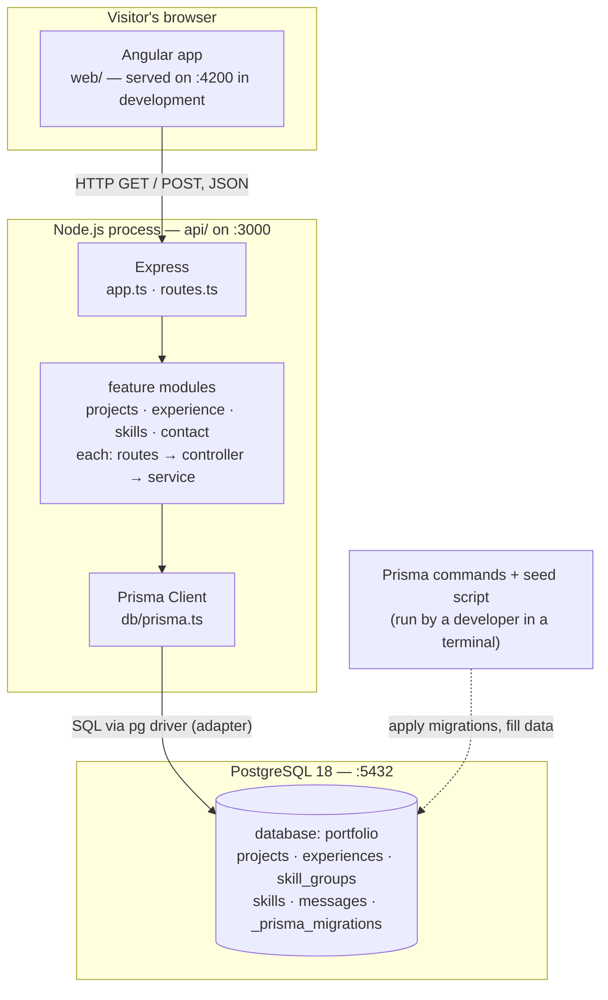
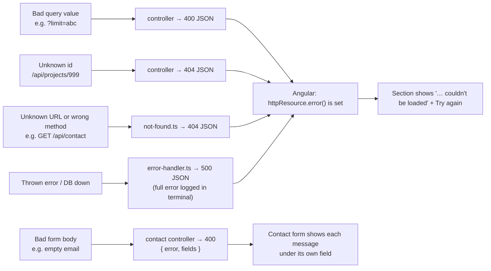

# 02 — System Architecture

[← 01 Overview](01-project-overview.md) · [Docs home](README.md) · Next: [03 — Frontend](03-frontend-documentation.md)

## In plain English

Three separate programs run at the same time and talk to each other in a chain. The browser only ever talks to the API; the API is the only thing that talks to the database. Each program has one job and does not reach into the others.

## Components

Reading the diagram, top to bottom:

1. The **Angular app** runs inside the visitor's browser. In development it is served by `ng serve` on port 4200.
2. It sends **HTTP requests** to the **API**, a Node.js program on port 3000: `GET` to read sections, `POST` to send a contact message.
3. Inside the API, **Express** receives the request and passes it to the matching **feature module**: the *routes* file picks a handler, the *controller* checks the input, the *service* decides what data to read or write.
4. The service calls **Prisma Client**, which writes SQL and sends it to **PostgreSQL** through the `pg` driver.
5. The dotted line is different: **Prisma commands** (migrations) and the **seed script** are run by a developer in a terminal. They are not part of the running website.

## Who is responsible for what

| Component | Responsibility | Must NOT do |
|---|---|---|
| Angular components (`web/src/app/sections/*`) | Display, user interaction, UI state (selected chip, form status) | Talk to the database |
| Angular services (`web/src/app/core/*.service.ts`) | Build API URLs, fetch or send data | Hold page layout |
| `api/src/app.ts` | Global middleware, mount routes, 404/500 | Contain feature logic |
| `*.routes.ts` | Map URL + method → controller function | Validate or query |
| `*.controller.ts` | Read `req` (URL values or body), **validate**, choose status code, send `res` | Touch the database |
| `*.service.ts` | **Business logic + data access** via Prisma | Know about `req`/`res` |
| `db/prisma.ts` | The one shared database client | — |
| PostgreSQL | **Persistence** and constraints (primary keys, NOT NULL, length limits, foreign key) | — |

## Technologies and protocols

| Concern | Choice |
|---|---|
| Browser ↔ API | HTTP/1.1, `GET` for reading, `POST` for the contact form, JSON bodies |
| Cross-origin rule | CORS: only `CORS_ORIGIN` (default `http://localhost:4200`) may read API responses |
| API ↔ database | PostgreSQL wire protocol via `pg`, wrapped by `@prisma/adapter-pg` |
| Data format | JSON; field names in **camelCase** (`displayOrder`), DB columns in **snake_case** (`display_order`); Prisma maps between them |
| Dates | Stored as real `DATE` / `TIMESTAMP` columns; sent as ISO text (`"2024-05-01T00:00:00.000Z"`); formatted by Angular's `date` pipe |
| Configuration | `api/.env` → `api/src/config/env.ts`; web API address in `web/src/app/core/api.config.ts` |

## Where validation, logic and persistence happen

- **Validation**: in the API controllers (`limit`, `offset`, `id`, and every contact-form field). The contact form is **also** checked in Angular for instant feedback, but the API never trusts the browser: anyone can send anything to an API.
- **Business logic**: in the API services (filters, counting, ordering, nesting skills inside groups, saving a message).
- **Persistence**: PostgreSQL. Prisma migrations define the structure; column length limits mirror the API's limits as a last safety net.

## How errors travel between layers

Express 5 forwards errors from `async` handlers to the error handler automatically, so controllers and services contain no `try/catch`.

## Configuration and deployment boundaries

- The web app knows the API address only through `API_BASE_URL`, which is simply **`/api`** (the website's own address). The website passes `/api` requests on to the API: `proxy.conf.json` on the laptop, `rewrites` in `web/vercel.json` when live. See [09](09-deployment-and-configuration.md#one-address-for-website-and-api).
- The API knows the database only through `DATABASE_URL`, and the allowed frontend only through `CORS_ORIGIN`.
- These values are the seams to change when deploying. See [09](09-deployment-and-configuration.md).

Related diagrams: [diagrams/system-architecture.md](diagrams/system-architecture.md), [diagrams/api-request-flow.md](diagrams/api-request-flow.md).
