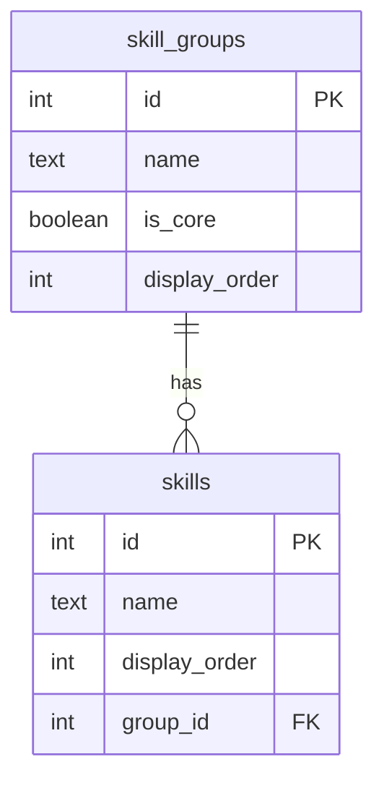

# 05 — Database (PostgreSQL + Prisma)

[← 04 API](04-api-documentation.md) · [Docs home](README.md) · Next: [06 — End-to-end flow](06-end-to-end-data-flow.md)

## In plain English

The database is like a spreadsheet file with sheets (**tables**). Each sheet has fixed **column** headers, and each **row** is one record. This project has five sheets: `projects`, `experiences`, `skill_groups`, `skills` and `messages`.

**Structure vs data:** the column headers are the *structure*, and the rows are the *data*. They're changed in different ways (see "Changing things" below).

**Who fills which sheet:**

| Table | Filled by | Read by |
|---|---|---|
| `projects` | The seed script (originally typed by hand in pgAdmin) | `GET /api/projects…` |
| `experiences`, `skill_groups`, `skills` | The seed script (`npm run seed`) | `GET /api/experience`, `GET /api/skills` |
| `messages` | **Visitors**, through the contact form (`POST /api/contact`) | The owner, in pgAdmin (no page shows them yet) |

## A. Fundamentals

| Topic | Value |
|---|---|
| Engine | PostgreSQL 18, local, `localhost:5432` |
| Database | `portfolio` |
| Schema (namespace) | `public` |
| Admin tool | pgAdmin 4 (to see new tables: right-click **Tables → Refresh**) |
| Access from code | Prisma 7 Client (`api/src/db/prisma.ts`) with the `@prisma/adapter-pg` driver adapter, which uses the `pg` driver underneath |
| Connection string | `DATABASE_URL` in `api/.env` (format in `api/.env.example`; never commit real values) |
| Structure definition | `api/prisma/schema.prisma` |
| Structure history | `api/prisma/migrations/` |
| Starting data | `api/prisma/seed.ts` |

### How the backend connects

```ts
// api/src/db/prisma.ts
const adapter = new PrismaPg({ connectionString: env.databaseUrl });
export const prisma = new PrismaClient({ adapter });
```

One client is created when the API starts and shared by all services. The adapter manages a pool of open connections and reuses them.

## B. Tables

### `projects`

One row per portfolio project shown in "Selected work".

| DB column | Type | Nullable | Default | Prisma field / JSON key |
|---|---|---|---|---|
| `id` | integer | No | auto-number (**primary key**) | `id` |
| `title` | text | No | — | `title` |
| `summary` | text | No | — | `summary` |
| `description` | text | No | — | `description` |
| `category` | text | **Yes** | — | `category` |
| `image_url` | text | Yes | — | `imageUrl` |
| `live_url` | text | Yes | — | `liveUrl` |
| `repo_url` | text | Yes | — | `repoUrl` |
| `display_order` | integer | No | `0` | `displayOrder` |

Rows: Flexipay (Payments), Arttha (Banking), Loan Origination System (Lending), in that display order. They now come from the seed script, so their ids change each time it runs; nothing depends on the ids.

### `experiences`

One row per job.

| DB column | Type | Nullable | Prisma field / JSON key |
|---|---|---|---|
| `id` | integer, primary key, auto-number | No | `id` |
| `title` | text | No | `title` |
| `company` | text | No | `company` |
| `company_note` | text | Yes | `companyNote` (e.g. "formerly PureSoftware") |
| `location` | text | No | `location` |
| `summary` | text | No | `summary` |
| `start_date` | **date** | No | `startDate` |
| `end_date` | **date** | **Yes** — empty = current job | `endDate` |

Real dates (not the text "May 2024") let the database sort jobs newest first and let Angular format them any way it likes.

### `skill_groups` and `skills` — the first relationship

`skill_groups`: `id` (PK), `name`, `is_core` (boolean, default false → stronger chip colour), `display_order`.

`skills`: `id` (PK), `name`, `display_order`, **`group_id`** → `skill_groups.id`.

**One-to-many:** one group (e.g. "Frontend") has many skills (Angular, TypeScript, …); each skill belongs to exactly one group.

- `group_id` is a **foreign key**: a column that points at a row in another table. Angular comparison: like each item in an array storing its parent's `id`.
- The database **refuses** a skill whose `group_id` doesn't exist.
- `ON DELETE CASCADE`: deleting a group also deletes its skills.

In `schema.prisma` the link looks like this:

```prisma
model SkillGroup {
  id     Int     @id @default(autoincrement())
  name   String
  skills Skill[]          // not a column: tells Prisma "a group has many skills"
  @@map("skill_groups")
}

model Skill {
  id      Int        @id @default(autoincrement())
  name    String
  groupId Int        @map("group_id")                                   // the real column
  group   SkillGroup @relation(fields: [groupId], references: [id], onDelete: Cascade)
  @@map("skills")
}
```

`skills Skill[]` and `group SkillGroup` are not columns; they let the code say "give me the groups **with** their skills".

### `messages`

One row per message sent through the contact form.

| DB column | Type | Nullable | Default | JSON key |
|---|---|---|---|---|
| `id` | integer, primary key | No | auto-number | `id` |
| `name` | varchar(**100**) | No | — | `name` |
| `email` | varchar(**254**) | No | — | `email` |
| `message` | varchar(**2000**) | No | — | `message` |
| `created_at` | timestamp | No | **`now()`** | `createdAt` |

The maximum lengths match the API's checks. The API gives friendly errors first; the database limits are a last safety net. `created_at` is filled in by PostgreSQL when the row is saved.

### `_prisma_migrations`

Created and managed by Prisma: one row per applied migration. Don't edit it by hand.

### Where names are converted

The database uses `snake_case`; TypeScript and JSON use `camelCase`. Prisma converts between them using `@map` (one column) and `@@map` (the table name) in `schema.prisma`. The API and Angular never see the snake_case names.

## C. Relationship diagram

See [diagrams/database-relationships.md](diagrams/database-relationships.md) for every table. The relationship part:



## D. Migrations (the structure's history)

A **migration** is a saved SQL file for one structure change, like a Git commit for tables.

| Folder | What it does | How it was created |
|---|---|---|
| `0_init/` | Recreates the original `projects` table | **Baseline**: the table was first made by hand in pgAdmin; `prisma migrate diff --from-empty` wrote this file and `prisma migrate resolve --applied 0_init` marked it as already done |
| `20261017133430_add_project_category/` | Adds `projects.category` | `npx prisma migrate dev --name add_project_category` |
| `20261019132505_add_experience_and_skills/` | Creates `experiences`, `skill_groups`, `skills` + the foreign key | `npx prisma migrate dev --name add_experience_and_skills` |
| `20261022104122_add_messages/` | Creates `messages` | `npx prisma migrate dev --name add_messages` |

⚠️ **Known discrepancy:** the live `projects` table uses `id … GENERATED ALWAYS AS IDENTITY`, but `0_init` creates `id SERIAL`. Both auto-number. A fresh database built from the migrations (e.g. when deploying) will use `SERIAL`. This doesn't affect the app.

Never edit a migration file after it has run: Prisma stores a checksum of each one and will complain.

### Changing things

| You want to… | It's a… | Do this |
|---|---|---|
| Add/remove a column or table | **Structure** change | Edit `schema.prisma` → `npx prisma migrate dev --name <what>` → `npx prisma generate` |
| Change projects, experience or skills | **Data** change | Edit the arrays in `prisma/seed.ts` → `npm run seed` (quick fixes: `npx prisma studio`). No migration |

Prisma 7's `migrate dev` does **not** regenerate the client, so always run `generate` afterwards. Don't change structure by hand in pgAdmin, or the schema and the history fall out of sync.

## E. The seed script (`api/prisma/seed.ts`)

**What it is:** a script that puts starting data into the database, instead of typing rows by hand.

**What it does when you run `npm run seed`:**

1. Deletes all rows in `projects`, `experiences` and `skill_groups` (which also deletes their skills, through the cascade). `messages` is **not** touched: those are real messages from visitors.
2. `createMany` adds the projects and the jobs.
3. For each group: a **nested create** saves the group and its skills together; Prisma fills in `group_id` for you:

```ts
prisma.skillGroup.create({
  data: { name: "Frontend", isCore: true, displayOrder: 1,
          skills: { create: [{ name: "Angular (15+)", displayOrder: 1 }, …] } },
});
```

4. Prints `Seeded: 3 projects, 3 jobs, 6 skill groups, 26 skills`.

Because it clears first, it is safe to run again and never creates duplicates. Because ids are auto-numbers, re-seeding gives the rows new ids (the site doesn't depend on them).

## F. Query walkthroughs

| Endpoint | Prisma call | Roughly equivalent SQL |
|---|---|---|
| `GET /api/projects` | `findMany({ where, orderBy, take, skip })` + `count({ where })` in `$transaction` | `SELECT * FROM projects WHERE … ORDER BY display_order LIMIT $1 OFFSET $2;` + `SELECT COUNT(*) …` |
| `GET /api/projects/:id` | `findUnique({ where: { id } })` | `SELECT * FROM projects WHERE id = $1 LIMIT 1;` |
| `GET /api/projects/categories` | `findMany({ where: { category: { not: null } }, distinct: ["category"], … })` | `SELECT DISTINCT category FROM projects WHERE category IS NOT NULL ORDER BY category;` |
| `GET /api/experience` | `experience.findMany({ orderBy: { startDate: "desc" } })` | `SELECT * FROM experiences ORDER BY start_date DESC;` |
| `GET /api/skills` | `skillGroup.findMany({ select: { …, skills: { … } } })` | Two queries: the groups, then `SELECT … FROM skills WHERE group_id IN (…) ORDER BY display_order;` — Prisma nests the results |
| `POST /api/contact` | `message.create({ data })` | `INSERT INTO messages (name, email, message) VALUES ($1, $2, $3) RETURNING id, created_at;` |

The `$1`-style placeholders mean values are sent separately from the SQL text, which prevents SQL injection.

## G. Data lifecycle

| Table | Create | Read | Update | Delete |
|---|---|---|---|---|
| `projects` | seed script | ✅ API | edit seed → re-run (or Prisma Studio) | seed clears them |
| `experiences`, `skill_groups`, `skills` | seed script | ✅ API | edit seed → re-run | seed clears them |
| `messages` | ✅ **API (contact form)** | pgAdmin only | — | by hand |
