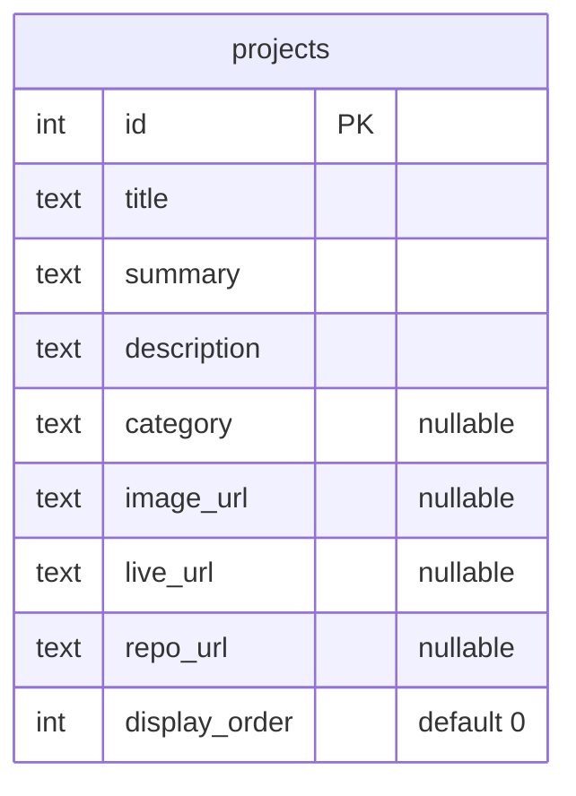

# 05 — Database (PostgreSQL + Prisma)

[← 04 API](04-api-documentation.md) · [Docs home](README.md) · Next: [06 — End-to-end flow](06-end-to-end-data-flow.md)

## In plain English

The database is like a spreadsheet file with sheets (**tables**). Each sheet has fixed **column** headers, and each **row** is one record. This project has one real table, `projects`, with one row per project. The API reads from it; nothing writes to it from the website yet.

**Structure vs data:** the column headers are the *structure*, and the rows are the *data*. They're changed in different ways (see "Changing things" below).

## A. Fundamentals

| Topic | Value |
|---|---|
| Engine | PostgreSQL 18, local, `localhost:5432` |
| Database | `portfolio` |
| Schema (namespace) | `public` |
| Admin tool | pgAdmin 4 |
| Access from code | Prisma 7 Client (`api/src/db/prisma.ts`) with the `@prisma/adapter-pg` driver adapter, which uses the `pg` driver underneath |
| Connection string | `DATABASE_URL` in `api/.env` (format in `api/.env.example`; never commit real values) |
| Structure definition | `api/prisma/schema.prisma` |
| Structure history | `api/prisma/migrations/` |

### How the backend connects

```ts
// api/src/db/prisma.ts
const adapter = new PrismaPg({ connectionString: env.databaseUrl });
export const prisma = new PrismaClient({ adapter });
```

One client is created when the API starts and shared by all services. The adapter manages a pool of open connections and reuses them.

## B. Tables

### `projects`

**Purpose:** one row per portfolio project shown in "Selected work".

| DB column | Type | Nullable | Default | Key / constraint | Prisma field / JSON key |
|---|---|---|---|---|---|
| `id` | integer | No | auto-number | **Primary key** (`projects_pkey`) | `id` |
| `title` | text | No | — | — | `title` |
| `summary` | text | No | — | — | `summary` |
| `description` | text | No | — | — | `description` |
| `category` | text | **Yes** | — | — | `category` |
| `image_url` | text | Yes | — | — | `imageUrl` |
| `live_url` | text | Yes | — | — | `liveUrl` |
| `repo_url` | text | Yes | — | — | `repoUrl` |
| `display_order` | integer | No | `0` | — | `displayOrder` |

- **Relationships:** none yet (single table).
- **Indexes:** only the primary key's index.
- **Read by:** `GET /api/projects`, `GET /api/projects/:id`, `GET /api/projects/categories`.
- **Written by:** no API endpoint. Rows are maintained by hand (pgAdmin / Prisma Studio).
- **Current rows** (verified earlier): ids **1** (Flexipay, Payments), **3** (Arttha, Banking), **4** (Loan Origination System, Lending). Id 2 was deleted during learning, and ids are never reused. ❓ The exact current summary wording was not re-verified.

#### Where names are converted

The database uses `snake_case`; TypeScript and JSON use `camelCase`. The conversion happens in **Prisma**, configured in `schema.prisma`:

```prisma
model Project {
  imageUrl     String? @map("image_url")
  displayOrder Int     @default(0) @map("display_order")
  @@map("projects")
}
```

`@map` renames one column; `@@map` renames the table (model `Project` ↔ table `projects`). The API and Angular never see the snake_case names.

### `_prisma_migrations`

Created and managed by Prisma. One row per applied migration, so Prisma knows what this database already has. Don't edit it by hand.

## C. Relationship diagram



There's only one table, so there are no relationships yet. A one-to-many `project_metrics` table is planned (📝). See [diagrams/database-relationships.md](diagrams/database-relationships.md).

## D. Migrations (the structure's history)

A **migration** is a saved SQL file for one structure change, like a Git commit for tables.

| Folder | What it does | How it was created |
|---|---|---|
| `0_init/` | Recreates the original `projects` table | **Baseline**: the table was first made by hand in pgAdmin; `prisma migrate diff --from-empty` wrote this file, and `prisma migrate resolve --applied 0_init` marked it as already done, without running it |
| `20261017133430_add_project_category/` | `ALTER TABLE "projects" ADD COLUMN "category" TEXT;` | `npx prisma migrate dev --name add_project_category` |

⚠️ **Discrepancy to know about:** the live table was created with `id INTEGER GENERATED ALWAYS AS IDENTITY`, but `0_init/migration.sql` creates `id SERIAL`. Both auto-number. A fresh database built from the migrations (e.g. when deploying) will use `SERIAL`, while the local one uses `IDENTITY`. This doesn't affect the app; noted for accuracy.

### Changing things

| You want to… | It's a… | Do this |
|---|---|---|
| Add/remove a column or table | **Structure** change | Edit `schema.prisma` → `npx prisma migrate dev --name <what>` → `npx prisma generate` |
| Add/edit/delete a project | **Data** change | pgAdmin (`INSERT`/`UPDATE`/`DELETE`) or `npx prisma studio`. No migration |

Prisma 7's `migrate dev` does **not** regenerate the client by itself, so always run `generate` afterwards. Don't change structure by hand in pgAdmin any more, or the schema and the history fall out of sync.

## E. Query walkthroughs

| Endpoint | Prisma call (in `projects.service.ts`) | Roughly equivalent SQL |
|---|---|---|
| `GET /api/projects` | `findMany({ where, orderBy: { displayOrder: "asc" }, take, skip })` + `count({ where })` in `$transaction` | `SELECT * FROM projects WHERE … ORDER BY display_order LIMIT $1 OFFSET $2;` and `SELECT COUNT(*) FROM projects WHERE …;` |
| `GET /api/projects/:id` | `findUnique({ where: { id } })` | `SELECT * FROM projects WHERE id = $1 LIMIT 1;` |
| `GET /api/projects/categories` | `findMany({ where: { category: { not: null } }, distinct: ["category"], select: { category: true }, orderBy: { category: "asc" } })` | `SELECT DISTINCT category FROM projects WHERE category IS NOT NULL ORDER BY category;` |

`title` uses a case-insensitive *contains* and `category` a case-insensitive *equals* (PostgreSQL `ILIKE`). The `$1`-style placeholders mean values are sent separately from the SQL text, which prevents SQL injection.

The results become typed `Project` objects (the type is generated by Prisma), then JSON in the controller, then cards in Angular. See [06](06-end-to-end-data-flow.md).

## F. Data lifecycle

| Operation | Supported by the app? | How it happens today |
|---|---|---|
| Create | ❌ | By hand (pgAdmin / Prisma Studio) |
| Read | ✅ | The three GET endpoints |
| Update | ❌ | By hand |
| Delete | ❌ | By hand |

There are no write endpoints yet. A contact form (📝) would be the first one.
