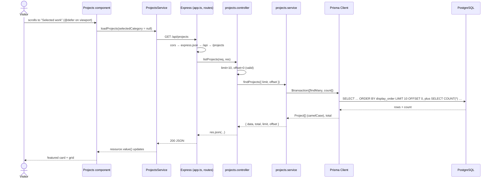
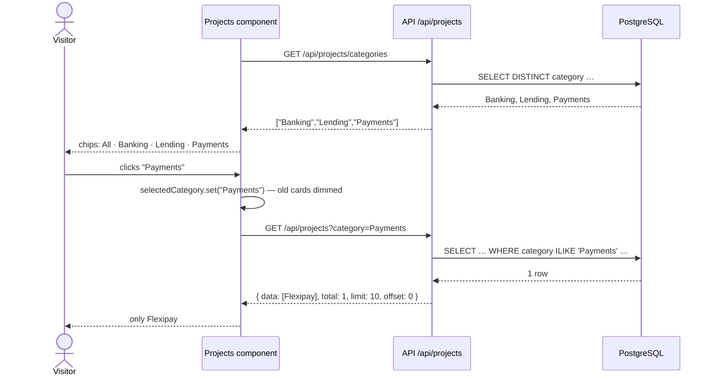

# 06 — End-to-End Data Flow

[← 05 Database](05-database-documentation.md) · [Docs home](README.md) · Next: [07 — Local setup](07-local-setup-and-development.md)

This page follows real features from the visitor's screen to the database and back. Not every feature uses all three layers; static sections are covered first, because "no request at all" is also a flow.

---

## Flow 1 — Static sections (hero, numbers, "What I do")

**In plain English:** these are written into the website itself. When the page opens, they appear straight away; nothing is fetched.

1. Browser loads `index.html` → `main.ts` bootstraps `App`.
2. `app.html` renders `<app-hero />`, `<app-impact-strip />` and `<app-expertise />`.
3. Their text and numbers come from arrays/objects in their own `.ts` files.

No API, no database. Failure points: none at runtime (mistakes surface at build time).

**CV download:** the **Download CV** link points to `Devaangini-Mehta-CV.pdf`, which Angular serves from `web/public/`. The browser downloads it directly; the API isn't involved.

---

## Flow 2 — Loading the projects (first view)

**In plain English:** when you scroll to "Selected work", the site asks the server for the projects, the server asks the database, and the answer comes back and becomes cards.

### Step by step

1. **Visitor scrolls**; the `@defer (on viewport)` placeholder in `web/src/app/app.html` enters the viewport.
2. **Angular renders `Projects`** (`web/src/app/sections/projects/projects.ts`). Its field initializers call the service:
   - `loadCategories()` → request A
   - `loadProjects(this.selectedCategory)` with `null` → request B
3. **The service builds the request** (`web/src/app/core/projects.service.ts`): `GET http://localhost:3000/api/projects` with no params.
4. **The browser sends it.** Different port, so the browser applies **CORS**.
5. **API receives it** (`api/src/app.ts`): `cors` adds the allow header for `http://localhost:4200` → `express.json()` → `/api` → `routes.ts` → `/projects` → `projects.routes.ts` `GET "/"` → `listProjects`.
6. **Controller validates** (`projects.controller.ts`): `limit` = 10, `offset` = 0 (defaults), no `title`, no `category`.
7. **Service queries** (`projects.service.ts` → `findProjects`): `findMany` + `count` in one transaction.
8. **Prisma → PostgreSQL** (`db/prisma.ts`): SQL is sent through the `pg` adapter; rows come back.
9. **Prisma maps names**: `display_order` → `displayOrder`, and so on.
10. **Controller responds**: `res.json({ data, total, limit, offset })`.
11. **Angular receives it**: `resource.value()` updates → `list` → `featured` and `others` recompute.
12. **UI updates**: the skeleton is replaced by the featured card and the grid.

### Sequence diagram

### Example response

See [04 — `GET /api/projects`](04-api-documentation.md#get-apiprojects--list-projects).

### Failure points

| Where | What happens | What the visitor sees |
|---|---|---|
| API not running | Network error | "Projects couldn't be loaded." + Try again |
| CORS origin mismatch | Browser blocks the response | Same error state (Network tab shows "CORS error") |
| Database down / bad `DATABASE_URL` | Prisma throws → `error-handler.ts` → 500, error logged in API terminal | Same error state |
| Table empty | 200 with `data: []` | "No projects to show yet." |

---

## Flow 3 — Filtering by a category chip

**In plain English:** clicking **Payments** makes the site ask the server again, this time for Payments projects only. The old cards stay faded until the new ones arrive.

1. On first render, `loadCategories()` fetched `GET /api/projects/categories` → `["Banking","Lending","Payments"]` → chips **All · Banking · Lending · Payments**.
2. Visitor clicks **Payments** → `selectCategory('Payments')` → `selectedCategory` signal = `'Payments'`.
3. `httpResource` notices that a signal it reads changed and re-runs → `GET /api/projects?category=Payments`.
4. While loading, `linkedSignal` keeps the previous cards; `.results--loading` dims them and `aria-busy="true"` is set.
5. API: controller reads `category = "Payments"` → service adds `category equals "Payments" (case-insensitive)` to `where` → Prisma → DB.
6. Response `{ data: [Flexipay], total: 1, … }` → `list` updates → only Flexipay is shown, as the featured card.
7. Clicking **All** sets the signal back to `null` → request without params → all projects.

If the categories request fails, no chips are shown; the project list still works.

---

## Flow 4 — One project by id (API only)

`GET /api/projects/:id` exists in the API ✅ but **the website does not use it yet** (there's no project detail page). Test it directly: `http://localhost:3000/api/projects/1` → 200, `/2` → 404 (deleted row), `/abc` → 400.

---

## Summary table

| Feature | Web | API | Database |
|---|---|---|---|
| Hero, numbers, expertise | static | — | — |
| CV download | static file | — | — |
| Projects list | `Projects` + `ProjectsService.loadProjects` | `GET /api/projects` | `projects` (read) |
| Category chips | `ProjectsService.loadCategories` + signal | `GET /api/projects/categories`, `?category=` | `projects.category` (read) |
| Project by id | not used | `GET /api/projects/:id` | `projects` (read) |
