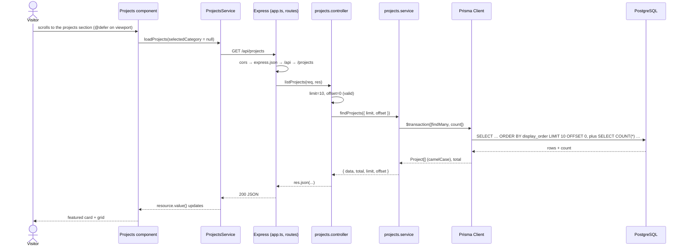
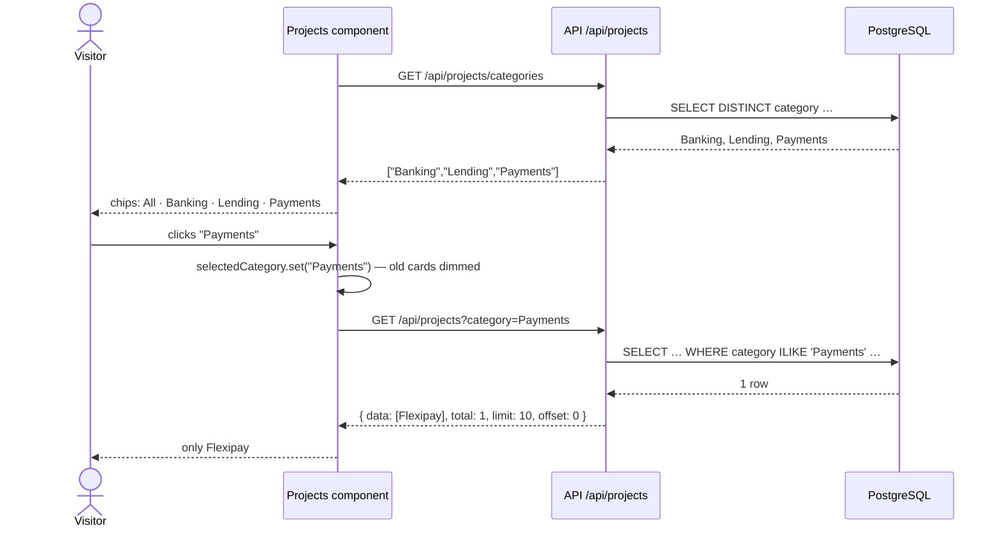
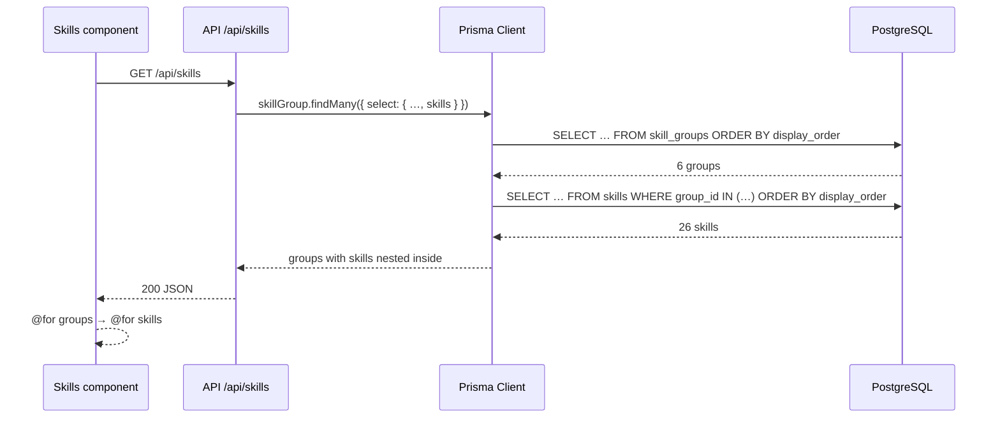
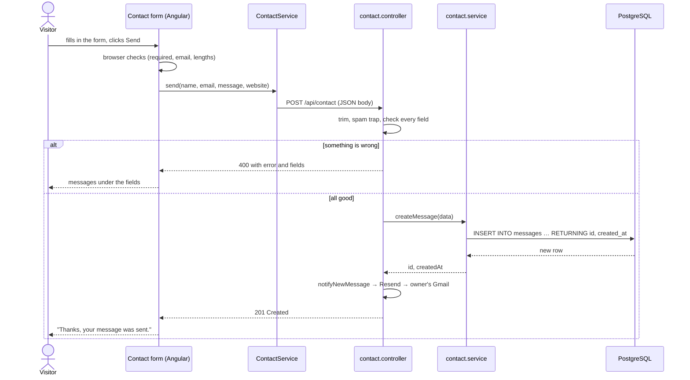
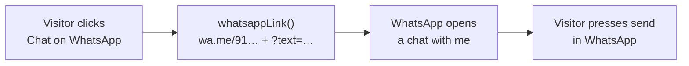
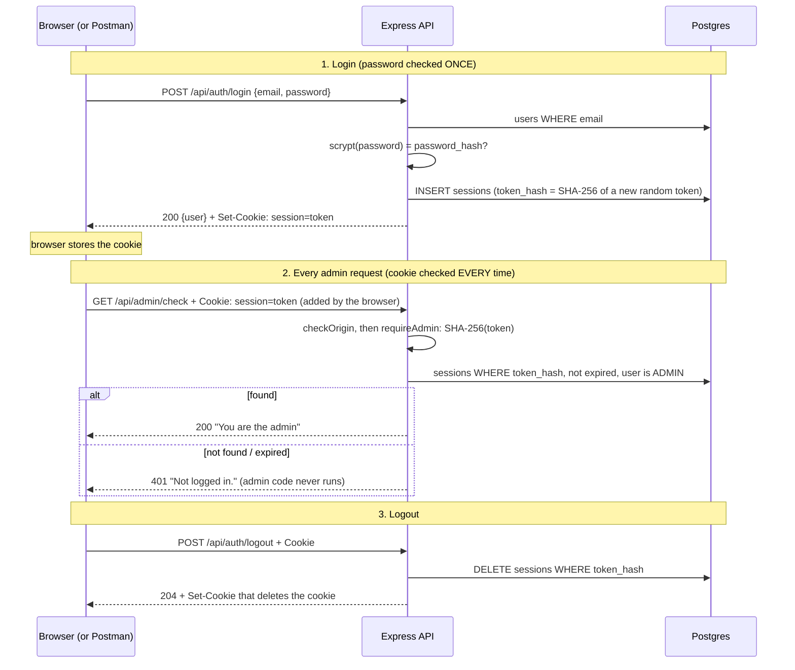

# 06 — End-to-End Data Flow

[← 05 Database](05-database-documentation.md) · [Docs home](README.md) · Next: [07 — Local setup](07-local-setup-and-development.md)

This page follows real features from the visitor's screen to the database and back. Not every feature uses all three layers; static sections are covered first, because "no request at all" is also a flow. Flows 2–5 **read** from the database; Flow 6 **writes** to it.

> Mental model: the database is an Excel file. Flows 2–5 *read* sheets on every page load. Filling the sheets happens separately (by hand, by `npm run seed`, or — in Flow 6 — by a visitor).

---

## Flow 1 — Static sections (hero, numbers, "What I do", footer)

**In plain English:** these are written into the website itself. When the page opens, they appear straight away; nothing is fetched.

1. Browser loads `index.html` → `main.ts` bootstraps `App`.
2. `app.html` renders `<app-hero />`, `<app-impact-strip />`, `<app-expertise />` and `<app-footer />`.
3. Their text and numbers come from arrays/objects in their own `.ts` files.

No API, no database. Failure points: none at runtime (mistakes surface at build time).

**CV download and photo:** the **Download CV** link points to `Devaangini-Mehta-CV.pdf` and the photo is `headshot.jpg`, both served by Angular from `web/public/`. The API isn't involved.

---

## Flow 2 — Loading the projects (first view)

**In plain English:** when you scroll to the projects section, the site asks the server for the projects, the server asks the database, and the answer comes back and becomes cards.

### Step by step

1. **Visitor scrolls**; the `@defer (on viewport)` placeholder in `web/src/app/app.html` enters the viewport.
2. **Angular renders `Projects`** (`web/src/app/sections/projects/projects.ts`). Its field initializers call the service:
   - `loadCategories()` → request A
   - `loadProjects(this.selectedCategory)` with `null` → request B
3. **The service builds the request** (`web/src/app/core/projects.service.ts`): `GET /api/projects` with no params (the website's own address; the dev server or Vercel passes it on to the API).
4. **The browser sends it.** Different port, so the browser applies **CORS**.
5. **API receives it** (`api/src/app.ts`): `cors` adds the allow header for `http://localhost:4200` → `express.json()` → `/api` → `routes.ts` → `/projects` → `projects.routes.ts` `GET "/"` → `listProjects`.
6. **Controller validates** (`projects.controller.ts`): `limit` = 10, `offset` = 0 (defaults), no `title`, no `category`.
7. **Service queries** (`projects.service.ts` → `findProjects`): `findMany` + `count` in one transaction.
8. **Prisma → PostgreSQL** (`db/prisma.ts`): SQL is sent through the `pg` adapter; rows come back.
9. **Prisma maps names**: `display_order` → `displayOrder`, and so on.
10. **Controller responds**: `res.json({ data, total, limit, offset })`.
11. **Angular receives it**: `resource.value()` updates → `list` → `featured` and `others` recompute.
12. **UI updates**: the skeleton is replaced by the featured card and the grid.

### Sequence diagram



### Example response

See [04 — `GET /api/projects`](04-api-documentation.md#get-apiprojects--list-projects).

### Failure points

| Where | What happens | What the visitor sees |
|---|---|---|
| API not running | Network error | "Projects couldn't be loaded." + Try again |
| CORS origin mismatch | Browser blocks the response | Same error state (Network tab shows "CORS error") |
| Database down / bad `DATABASE_URL` | Prisma throws → `error-handler.ts` → 500, error logged in API terminal | Same error state |
| Table empty | 200 with `data: []` | "No projects to show yet." |

---

## Flow 3 — Filtering by a category chip

**In plain English:** clicking **Payments** makes the site ask the server again, this time for Payments projects only. The old cards stay faded until the new ones arrive.

1. On first render, `loadCategories()` fetched `GET /api/projects/categories` → `["Banking","Lending","Payments"]` → chips **All · Banking · Lending · Payments**.
2. Visitor clicks **Payments** → `selectCategory('Payments')` → `selectedCategory` signal = `'Payments'`.
3. `httpResource` notices that a signal it reads changed and re-runs → `GET /api/projects?category=Payments`.
4. While loading, `linkedSignal` keeps the previous cards; `.results--loading` dims them and `aria-busy="true"` is set.
5. API: controller reads `category = "Payments"` → service adds `category equals "Payments" (case-insensitive)` to `where` → Prisma → DB.
6. Response `{ data: [Flexipay], total: 1, … }` → `list` updates → only Flexipay is shown, as the featured card.
7. Clicking **All** sets the signal back to `null` → request without params → all projects.



If the categories request fails, no chips are shown; the project list still works.

---

## Flow 4 — Experience (reading dates)

**In plain English:** as soon as the page opens, the Experience section asks for the jobs. They come back newest first, and Angular turns the dates into "May 2024 – Present".

1. `Experience` is created → `inject(ExperienceService).loadExperiences()` → `GET /api/experience`.
2. API: `experience.routes.ts` → `listExperiences` (nothing to validate) → `findExperiences` → `prisma.experience.findMany({ orderBy: { startDate: "desc" } })`.
3. PostgreSQL returns the 3 rows from `experiences`, newest `start_date` first.
4. JSON arrives with dates as text (`"2024-05-01T00:00:00.000Z"`) and `endDate: null` for the current job.
5. The template formats them with `date: 'MMM y' : 'UTC'` and shows "Present" for `null`. The first job gets the pulsing apricot dot.

Failure points: same as Flow 2; the section shows "Experience couldn't be loaded." + **Try again**.

---

## Flow 5 — Skills (reading two linked tables)

**In plain English:** the Skills section asks for "every group, with its skills inside". The database keeps groups and skills in two sheets linked by `group_id`; Prisma joins them and sends one nested answer.

1. `Skills` is created → `loadSkillGroups()` → `GET /api/skills`.
2. API: `listSkillGroups` → `findSkillGroups` → `skillGroup.findMany({ select: { id, name, isCore, skills: { … } } })`.
3. Prisma asks PostgreSQL for the groups, then for the skills whose `group_id` is one of those groups, and **nests** each group's skills inside it.
4. JSON: `[{ "name": "Frontend", "isCore": true, "skills": [{ "name": "Angular (15+)" }, …] }, …]`.
5. Angular loops twice (`@for` groups → `@for` skills), adds folder labels like `frontend/`, and the chips pop in as you scroll.



---

## Flow 6 — Sending a contact message (writing)

**In plain English:** this is the opposite direction. The visitor types a message; the site sends it to the server; the server checks it and saves a new row; the page says thanks.

1. The visitor fills in **Name**, **Email**, **Message** and clicks **Send message**.
2. `Contact.submit()` (`web/src/app/sections/contact/contact.ts`): if the form is invalid, every field shows its error and **nothing is sent**.
3. Otherwise `status` becomes `'sending'` (button disabled, "Sending…") and `ContactService.send(...)` calls `HttpClient.post('/api/contact', body)`.
4. API: `cors` → `express.json()` turns the JSON text into `req.body` → `/api/contact` → `contactRouter.post("/")` → `sendMessage`.
5. Controller: trims each field; if the hidden `website` field is filled (a bot), answers 201 without saving; otherwise checks every rule and collects all problems.
6. Problems → **400** `{ error, fields }` → Angular shows each message under its field (`status` back to `'idle'`).
7. All good → `createMessage()` → `prisma.message.create(...)` → `INSERT INTO messages …`; PostgreSQL fills in `id` and `created_at`.
8. `notifyNewMessage()` asks **Resend** to email the owner ("New portfolio message from …", Reply-To = the visitor). If that fails, it's only logged.
9. API answers **201** `{ ok: true, id, createdAt }` → `status` = `'sent'` → "Thanks, your message was sent." The form is reset.



| Where it can fail | What happens | What the visitor sees |
|---|---|---|
| Browser checks fail | Nothing is sent | Red messages under the fields |
| API checks fail | 400 | The API's messages under the fields |
| API not running / DB down / 500 | Request fails | Red box: "Something went wrong… email me directly." |

Check the result: locally in pgAdmin (`SELECT * FROM messages ORDER BY created_at DESC;`), live in Vercel → Storage → portfolio-db → Data Editor → `messages`, and in the owner's Gmail.

> **Two databases, same code.** Messages sent with Postman or from `localhost:4200` go to the **local** API and the **local** database (pgAdmin). Messages from the **live site** go to the live API and **Neon**. The only difference is `DATABASE_URL`.

---

## Flow 6b — Too many messages (rate limiting, two layers)

**In plain English:** two guards stand between the **Send** button and the database. The first one (Vercel's firewall) watches **how fast** one computer sends. The second one (our code) watches **how many** messages one email address — and everyone together — send in an hour.

```
Click Send → the request goes to Vercel
  ① Vercel Firewall (a dashboard setting, not in our code)
       more than 3 POSTs to /api/contact from this IP in 60 s?
       yes → 429 (no text) ───────────────────┐   ← our API never runs
       no  → passes to our API                 │
  ② Our API code (contact.controller.ts + contact.service.ts)
       this email sent 3+ in the last hour, or 20+ in total?
       yes → 429 + "Too many messages right now…" ┤
       no  → save in Neon → email via Resend → 201
                                               ▼
  Angular (contact.ts) sees status 429 → shows "You've sent several messages…"
```

| | ① Firewall | ② Code |
|---|---|---|
| Where it lives | Vercel → portfolio → **Firewall** (rule "Contact form rate limit") | `api/src/modules/contact/contact.controller.ts` (`RATE_LIMIT`) and `contact.service.ts` (`countRecentMessages`) |
| Runs | **Before** our API — a blocked request never starts our code | **Inside** our API, after the field checks, before saving |
| Counts by | The visitor's **IP address** (it can't see the email) | The **email address** + **all messages** (from the database) |
| Limit | **3 per 60 seconds** (`POST` only — the browser's automatic `OPTIONS` check is not counted) | **3 per email per hour**, **20 in total per hour** |
| Question it answers | "How **fast**?" | "How **many**?" |
| Works locally? | No (live only) | Yes |
| What it sends back | 429 with **no** text of ours | 429 with our text + `Retry-After` |

**Remember:**
- The browser always sends the request; the firewall stops it **at Vercel's door**, so our Express code, the database count, the save and the email are all skipped.
- The message box on the page comes from **Angular**, which only looks at the status **429** — so both layers show the **same box**. To see which layer blocked it: DevTools → Network → the request → **Response** (our code's 429 has our text; the firewall's doesn't). Vercel → Firewall shows firewall blocks; Vercel → Logs has no line for them.
- It's **429** "Too Many Requests" (not 409, which means "Conflict").

**Examples (fresh email, one computer):**

| What you do | Result |
|---|---|
| Same email, 4 sends within a minute | 1–3 ✅, 4th ❌ (firewall) |
| Same email, a 4th send after a minute, same hour | ❌ (code: 3 per email per hour) |
| Different emails, 4 sends within a minute | 1–3 ✅, 4th ❌ (firewall) |
| Different emails, after the minute passes | ✅ again (until 20 in total that hour) |

Earlier test messages from the last hour count too, so always test with a brand-new email.

---

## Flow 6c — "Chat on WhatsApp" (no API, no database)

Next to **Send** there is a second button: **Chat on WhatsApp**. It is a plain link, so this flow never touches our API or the database.

### Step by step
1. The visitor clicks **Chat on WhatsApp** (it can be clicked at any time, even with an empty form).
2. `whatsappLink()` in `contact.ts` builds the address **at that moment**:
   - starts from `https://wa.me/` + my number in international format (`91…`, no `+`, spaces or dashes);
   - if a **name** is typed → "Hi Devaangini, I'm *name*." otherwise "Hi Devaangini,";
   - if a **message** is typed it's added; otherwise "I found your portfolio and would like to connect.";
   - the text is made URL-safe with `encodeURIComponent` and added as `?text=…`.
3. The link opens in a new tab: WhatsApp (app or web) opens a chat with me, the text already filled in. The visitor presses send **inside WhatsApp**.



### Angular analogy
It's like a `routerLink` that leads **out** of the site: no `HttpClient`, no service, no signal changes. The only "logic" is building a string from the current form values.

### Send vs WhatsApp

| | **Send** | **Chat on WhatsApp** |
|---|---|---|
| Goes through our API | ✅ `POST /api/contact` | ❌ |
| Saved in `messages` | ✅ | ❌ |
| Email to me (Resend) | ✅ | ❌ (I get it in WhatsApp) |
| Rate limited (Flow 6b) | ✅ | ❌ (WhatsApp handles spam) |
| Needs the form valid | ✅ | ❌ |

> **Privacy note:** the number sits inside the link, so anyone can see it by hovering the button. That was a deliberate choice; it's not shown as text on the page.

---

## Flow 7 — One project by id (API only)

`GET /api/projects/:id` exists in the API ✅ but **the website does not use it yet** (there's no project detail page). Test it directly: take an `id` from `GET /api/projects`, then `http://localhost:3000/api/projects/<that id>` → 200, `/999` → 404, `/abc` → 400. (Ids change each time the seed runs.)

---

## Flow 8 — Logging in and an admin request (Blog milestone 3, API only for now)

No page uses this yet (the admin page comes in milestone 6); test it with Postman. Full details: [04 — Authentication](04-api-documentation.md#authentication-blog-milestone-3).



| Step | Status | What I see in Postman |
|---|---|---|
| Login right | 200 | Response **Headers** → `Set-Cookie: session=…` |
| Login wrong | 401 | "Wrong email or password." |
| 5× wrong | 429 | "Too many failed attempts…" |
| `/api/admin/check` logged in | 200 | "You are the admin: …" |
| `/api/admin/check` logged out | 401 | "Not logged in." |

---

## Summary table

| Feature | Web | API | Database |
|---|---|---|---|
| Hero, numbers, expertise, footer | static | — | — |
| CV download, photo | static files | — | — |
| Projects list | `Projects` + `ProjectsService.loadProjects` | `GET /api/projects` | `projects` (read) |
| Category chips | `ProjectsService.loadCategories` + signal | `GET /api/projects/categories`, `?category=` | `projects.category` (read) |
| Experience | `Experience` + `ExperienceService` | `GET /api/experience` | `experiences` (read) |
| Skills | `Skills` + `SkillsService` | `GET /api/skills` | `skill_groups` + `skills` (read, linked) |
| Contact form | `Contact` + `ContactService` (POST) | `POST /api/contact` | `messages` (**write**) |
| Chat on WhatsApp | `Contact.whatsappLink()` builds a `wa.me` link | — | — |
| Too many messages | `Contact` shows the "several messages" box on 429 | Vercel Firewall (per IP) + `RATE_LIMIT` in the controller | `messages` (counted, not written) |
| Project by id | not used | `GET /api/projects/:id` | `projects` (read) |
| Admin login / guard | not yet (milestone 6) | `/api/auth/login`, `/me`, `/logout`; `requireAdmin` on `/api/admin` | `users`, `sessions` |
