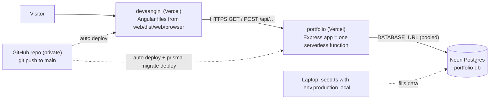

# 09 — Deployment and Configuration

[← 08 Testing](08-testing-and-debugging.md) · [Docs home](README.md) · Next: [10 — Security](10-security-and-maintenance.md)

> **Status: ✅ live since 2026-10-25** on Vercel (website + API) with a Neon PostgreSQL database.

## In plain English

The same three pieces that run on the laptop now also run on the internet:

| Local | Live | Where |
|---|---|---|
| `web` on `localhost:4200` | the built Angular files | Vercel project **devaangini** → `https://devaangini-portfolio.vercel.app` ❓ *(renamed from `devaangini-nine.vercel.app`; confirm the final name in Vercel → Domains)* |
| `api` on `localhost:3000` | Express as **one serverless function** (code that starts on demand when a request arrives) | Vercel project **portfolio** → `https://portfolio-neon-six-56.vercel.app/api/…` |
| PostgreSQL on the laptop | **Neon** — PostgreSQL in the cloud | Vercel → Storage → **portfolio-db** (free plan) |

Both Vercel projects are built from the **same private GitHub repository**, each from its own folder. **Every `git push` to `main` redeploys both automatically.**

## What was changed to make it deployable

### API (`api/`)

| Change | Why |
|---|---|
| `src/app.ts` ends with `export default app;` | Vercel looks for `src/app.ts` (or `index`/`server`) with a **default export** and turns the app into one serverless function. Locally `server.ts` still calls `app.listen`. |
| `prisma7.config.ts` renamed to **`prisma.config.ts`** | Prisma only finds its config file automatically under that exact name. |
| Config uses `DATABASE_URL_UNPOOLED ?? DATABASE_URL` | Neon gives two addresses: **pooled** (shared connections, for the running app) and **unpooled** (direct, needed by migrations). Locally only `DATABASE_URL` exists. |
| Script `vercel-build` = `prisma generate && prisma migrate deploy` | Vercel runs `vercel-build` on every deploy: it prepares Prisma's code and **applies any new migrations to Neon** automatically. |
| TypeScript 7 → **~6.0.3** | Vercel's TypeScript step failed with TS 7 (`TS2688 Cannot find type definition file for 'node'`). |
| `prisma/seed.ts` includes projects | One seed run fills everything the site shows. |

The `build` / `start` / `start:local` scripts and `tsconfig.build.json` let the API run as plain Node on any other host; Vercel doesn't need them.

### Website (`web/`)

| Change | Why |
|---|---|
| `src/environments/environment.ts` → live API URL; `environment.development.ts` → `http://localhost:3000/api` | The site must call a different API address locally and live. |
| `angular.json` → development config `fileReplacements` | `npm start` swaps in the development file; `npm run build` keeps the live one. |
| `core/api.config.ts` → `factory: () => environment.apiBaseUrl` | Every service still reads one `API_BASE_URL`. |
| `web/vercel.json` → `outputDirectory: "dist/web/browser"` | Angular puts the built site in a `browser` sub-folder; without this Vercel served a 404 page. |

### Vercel settings (done in the dashboard)

| Project | Setting | Value |
|---|---|---|
| portfolio (API) | Root Directory | `api` (preset Express) |
| portfolio (API) | Neon connection | env-var prefix **`DATABASE`** (the default `STORAGE` would have created `STORAGE_URL`, which the code doesn't read) → `DATABASE_URL`, `DATABASE_URL_UNPOOLED`, `PG*` |
| portfolio (API) | `CORS_ORIGIN` | the website's address, e.g. `https://devaangini-portfolio.vercel.app` (https, no trailing `/`) |
| devaangini (web) | Root Directory | `web` (preset Angular) |

Secrets live only in Vercel's settings (marked *Sensitive*) and in git-ignored `.env*` files on the laptop.

## Everyday operations

| I want to… | Do this |
|---|---|
| Publish a code change | Commit + push from the `portfolio/` root → both projects rebuild |
| Change table structure | Locally: `schema.prisma` → `npx prisma migrate dev --name …` → `npx prisma generate` → commit + push. The API build applies the migration to Neon |
| Change live content (projects, experience, skills) | Edit `prisma/seed.ts` → in `api/`: `npx tsx --env-file=.env.production.local prisma/seed.ts` (also run `npm run seed` for local) |
| Read contact messages | Vercel → Storage → portfolio-db → **Data Editor** → `messages` |
| Change a setting (e.g. `CORS_ORIGIN`) | Vercel → project → Environment Variables → edit → **Redeploy** (settings apply only to new builds) |
| Undo a bad deploy | Vercel → project → **Instant Rollback** |

`api/.env.production.local` (git-ignored) holds one line, `DATABASE_URL=<Neon's unpooled address>`, copied from Storage → portfolio-db → `.env.local` → *Show secret*. Never paste it anywhere else.

## Things to know

- **Use the production domains.** The extra Vercel addresses (`…-git-main-…`, `…-<random>-…`) are protected by a Vercel login by default; visitors can't open them.
- **"Redeploy" rebuilds the commit of that deployment.** To build the newest commit, push again or use the latest row in the Deployments list.
- **Separate domains → CORS.** If the website's address changes, update `CORS_ORIGIN` and redeploy the API, or every section shows "couldn't be loaded".
- **Build-log warnings that are harmless:** the `engines ">=22"` auto-upgrade notice, npm `cache-dir`, npm 11 "install scripts not covered by allowScripts", and "Prisma 8 available" (we stay on Prisma 7 on purpose).
- The CV PDF (with phone number) is publicly downloadable — the owner's explicit choice.

## 📝 Still to do

1. **Rate limiting** on `POST /api/contact` (Vercel Firewall rule or a shared store such as Upstash; an in-memory limiter doesn't work across serverless instances).
2. **Email notification** for new messages (Resend free tier); the API key goes in Vercel's settings.
3. `GET /api/health`; optionally a custom domain.

Note: Neon's tables were built from the migration history, so `projects.id` there is `SERIAL` (locally `IDENTITY`). Both auto-number; see [05](05-database-documentation.md#d-migrations-the-structures-history).
