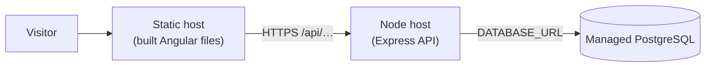

# 09 — Deployment and Configuration

[← 08 Testing](08-testing-and-debugging.md) · [Docs home](README.md) · Next: [10 — Security](10-security-and-maintenance.md)

> **Status: not deployed.** Deployment was deliberately postponed. Section 1 describes what exists today; section 2 is a **📝 proposed** plan, not something that has been done.

## 1. What exists today (verified)

| Concern | Current state | Where |
|---|---|---|
| Web build | `npm run build` (`ng build`, `@angular/build:application`) → static files in `web/dist/` | `web/package.json`, `angular.json` |
| API run | **Development only**: `npm run dev` = `tsx watch --env-file=.env src/server.ts` | `api/package.json` |
| API production build/start script | ❌ none (no `build` or `start` script, and `tsconfig.json` has `noEmit: true`) | — |
| API base URL in web | Hard-coded `http://localhost:3000/api` | `web/src/app/core/api.config.ts` |
| Database connection | `DATABASE_URL` from `.env` | `api/src/config/env.ts` |
| CORS | Single origin from `CORS_ORIGIN` (default `http://localhost:4200`) | `api/src/app.ts` |
| Port | `PORT` (default 3000) | `api/src/config/env.ts` |
| Logging | `console.log` on start; `console.error` for 500s | `server.ts`, `error-handler.ts` |
| Health check endpoint | ❌ none (a temporary `/api/health` existed early on and was removed) | — |
| Database migrations | Ready to replay with `npx prisma migrate deploy` | `api/prisma/migrations/` |

## 2. 📝 Proposed deployment plan

### Target shape

Three hosted pieces, mirroring local development. Hosting providers and their free plans change often, so check current offerings before choosing.

### Changes needed first

1. **API production scripts**: e.g. compile TypeScript to JavaScript (or run with `tsx` without `watch`), and add a `start` script that runs `prisma migrate deploy` before starting the server.
2. **Frontend API address**: make `API_BASE_URL` come from the build environment instead of the hard-coded localhost value.
3. **CORS**: set `CORS_ORIGIN` on the API host to the real site address.
4. **Health check**: add a lightweight `GET /api/health` so the host can tell whether the API is alive.
5. **Seed data**: a seed script, or a one-off data copy, so the production database isn't empty.

### Order of operations

1. Create the managed database → set `DATABASE_URL` on the API host.
2. Deploy the API → run `npx prisma migrate deploy` (builds the tables from the migration history) → add data.
3. Verify `https://<api-host>/api/projects`.
4. Build the web app with the production API URL → deploy the static files.
5. Set `CORS_ORIGIN` to the site URL → verify the projects load on the live site.

### Configuration per environment

| Setting | Local | Production (proposed) |
|---|---|---|
| `DATABASE_URL` | local PostgreSQL | provider's connection string (secret) |
| `CORS_ORIGIN` | `http://localhost:4200` | the live site URL |
| `PORT` | 3000 | usually provided by the host |
| `API_BASE_URL` (web) | `http://localhost:3000/api` | `https://<api-host>/api` |

Note: the migration history creates `id` as `SERIAL`, while the local table uses `IDENTITY`. Both auto-number; see [05](05-database-documentation.md#d-migrations-the-structures-history).
