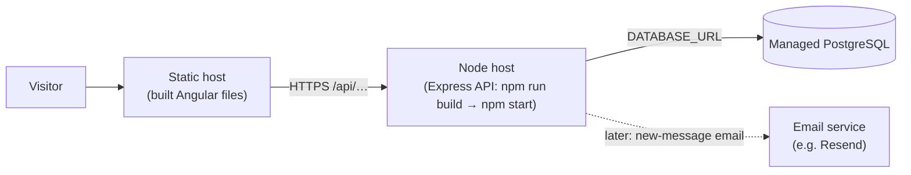

# 09 — Deployment and Configuration

[← 08 Testing](08-testing-and-debugging.md) · [Docs home](README.md) · Next: [10 — Security](10-security-and-maintenance.md)

> **Status: not deployed yet.** Section 1 describes what exists today. Section 2 is the **📝 plan** for putting the site online, which is the next step of the project.

## 1. What exists today (verified)

| Concern | Current state | Where |
|---|---|---|
| Web build | `npm run build` (`ng build`) → static files in `web/dist/` | `web/package.json`, `angular.json` |
| API (development) | `npm run dev` = `tsx watch --env-file=.env src/server.ts` | `api/package.json` |
| API (production) 🟡 | `npm run build` = `prisma generate && tsc -p tsconfig.build.json` → JavaScript in `api/dist/`; `npm start` = `node dist/src/server.js`; `npm run start:local` adds `--env-file=.env` | `api/package.json`, `api/tsconfig.build.json` |
| Database migrations | `npm run db:migrate` = `prisma migrate deploy` (applies every migration not yet applied) | `api/prisma/migrations/` |
| Starting data | `npm run seed` (experience + skills); projects not included yet | `api/prisma/seed.ts` |
| API base URL in web | `http://localhost:3000/api` | `web/src/app/core/api.config.ts` |
| Database connection | `DATABASE_URL` from `.env` | `api/src/config/env.ts` |
| CORS | Single origin from `CORS_ORIGIN` (default `http://localhost:4200`) | `api/src/app.ts` |
| Port | `PORT` (default 3000) | `api/src/config/env.ts` |
| Node version | `engines.node: ">=22"` in the API | `api/package.json` |
| Logging | `console.log` on start; `console.error` for 500s | `server.ts`, `error-handler.ts` |
| Health check endpoint | ❌ none yet | — |

### Why a build step for the API?

In development, `tsx` reads TypeScript directly, which is convenient but slower and needs extra tools. In production we **build once** — turn the TypeScript into plain JavaScript in `dist/` — and then plain `node` runs it. Angular comparison: `ng serve` vs `ng build`.

- `tsconfig.json` stays "check only" (`noEmit: true`), used by the editor and `npm run typecheck`.
- `tsconfig.build.json` extends it and turns output on (`outDir: dist`, `rootDir: .`), so `src/` and the generated Prisma client both end up under `dist/`.
- `prisma generate` runs first inside `build`, because the generated client is not in git.

🟡 Checked by Claude (the built server starts, answers 404 JSON and returns the safe 500 when the database is unreachable); the owner still needs to run `npm run build` + `npm run start:local` on Windows.

## 2. 📝 Deployment plan

### Target shape

Three hosted pieces, mirroring local development. Candidate free tiers to compare when we get there (check current offers first; they change): **Vercel / Netlify / Cloudflare Pages** for the Angular files, **Render / Railway** for the API, **Neon / Supabase** for PostgreSQL.

### Changes still needed

1. **Frontend API address**: make `API_BASE_URL` come from the build (e.g. Angular environment files) instead of the hard-coded localhost value.
2. **CORS**: set `CORS_ORIGIN` on the API host to the real site address.
3. **Health check**: a lightweight `GET /api/health` so the host can tell whether the API is alive.
4. **Projects data**: add projects to the seed (or copy them once) so the live database isn't missing them.
5. **Rate limiting** on `POST /api/contact` before it is public.
6. 📝 **Option C**: email the owner when a message arrives (Resend free tier: 100 emails/day, 3,000/month); its API key goes in the host's settings, never in git.

### Order of operations

1. Create the managed database → copy its connection string.
2. Create the API service: build command `npm run build`, start command `npm start`; set `DATABASE_URL`, `CORS_ORIGIN` (and `PORT` if the host requires it).
3. Run `npm run db:migrate` against the live database (builds the tables from the migration history), then `npm run seed` and add the projects.
4. Check `https://<api-host>/api/skills` in the browser.
5. Build the web app with the production API URL → deploy the static files.
6. Set `CORS_ORIGIN` to the final site URL → check that every section loads and the contact form saves a row.

### Configuration per environment

| Setting | Local | Production (planned) |
|---|---|---|
| `DATABASE_URL` | local PostgreSQL | provider's connection string (secret) |
| `CORS_ORIGIN` | `http://localhost:4200` | the live site URL |
| `PORT` | 3000 | usually provided by the host |
| `API_BASE_URL` (web) | `http://localhost:3000/api` | `https://<api-host>/api` |

Note: the migration history creates `projects.id` as `SERIAL`, while the local table uses `IDENTITY`. Both auto-number; see [05](05-database-documentation.md#d-migrations-the-structures-history).
