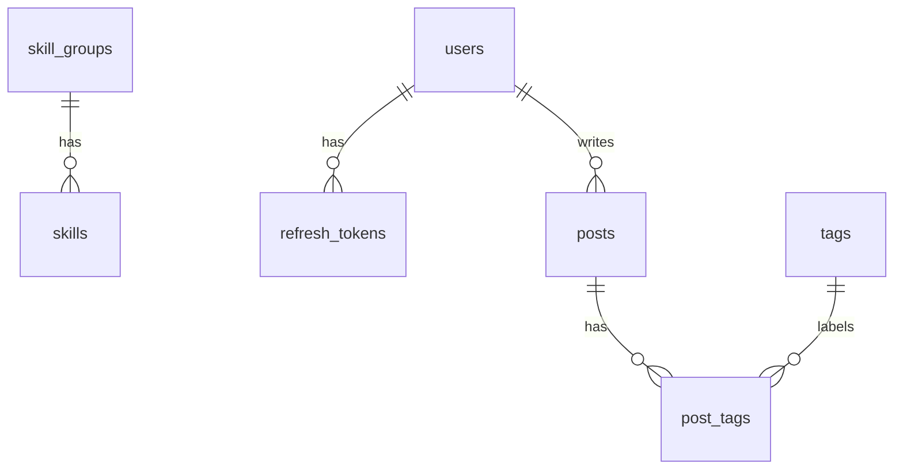

# 14 — Backend API Handbook

[← Docs home](README.md)

The single reference for the portfolio's backend: **every API, how to test it in Postman, how a request travels through the code, how the APIs use the database, and how to explain all of it in an interview.**

Written from the actual code (`api/src/`, `api/prisma/schema.prisma`) as of **9 Nov 2026**. Status labels:

| Label | Meaning |
|---|---|
| ✅ **Live** | implemented, tested, deployed to the live site |
| 🟢 **Implemented** | implemented and tested on the laptop; deployed with the next push, but not used by any page yet |
| 🕓 **Planned** | agreed in the Blog plan, **not built** |

---

## Contents
1. [The backend in one page](#1-the-backend-in-one-page)
2. [Public APIs vs Admin APIs](#2-public-apis-vs-admin-apis)
3. [API reference](#3-api-reference)
4. [Postman testing guide](#4-postman-testing-guide)
5. [Architecture and request lifecycle](#5-architecture-and-request-lifecycle)
6. [Database and API relationship](#6-database-and-api-relationship)
7. [Known gaps and limits](#7-known-gaps-and-limits)
8. [Interview preparation](#8-interview-preparation)

---

## 1. The backend in one page

| | |
|---|---|
| **What it is** | A REST API for the portfolio website and its blog: portfolio content (projects, experience, skills), a contact form, an admin login, admin blog management, and a public blog |
| **Stack** | Node.js 22+ · Express 5 · TypeScript · Prisma 7 (ORM) · PostgreSQL (local) / Neon (live) · Zod (input rules) · jose (JWT) · Resend (email) |
| **Base URL, laptop** | `http://localhost:3000/api` (API run with `npm run dev` in `api/`) |
| **Base URL, through the website** | `http://localhost:4200/api` on the laptop, `https://devaangini-portfolio.vercel.app/api` live. The website forwards every `/api` request to the API ("front desk": `web/proxy.conf.mjs` / `web/vercel.json`) |
| **Format** | JSON in, JSON out (except 204 responses, which have no body) |
| **Auth** | Admin only: a JWT **access token** (15 min) + a **refresh token** (7 days), both in httpOnly cookies. Visitors never log in |
| **Tests** | 48 automated tests (Vitest + Supertest), `npm test` in `api/` |

### All endpoints at a glance

| # | Method | Endpoint | Who | Status |
|---|---|---|---|---|
| 1 | GET | `/api/projects` | public | ✅ Live |
| 2 | GET | `/api/projects/categories` | public | ✅ Live |
| 3 | GET | `/api/projects/:id` | public | ✅ Live (no page uses it yet) |
| 4 | GET | `/api/experience` | public | ✅ Live |
| 5 | GET | `/api/skills` | public | ✅ Live |
| 6 | POST | `/api/contact` | public | ✅ Live |
| 7 | GET | `/api/posts` | public | 🟢 Implemented |
| 8 | GET | `/api/posts/:slug` | public | 🟢 Implemented |
| 9 | GET | `/api/tags` | public | 🟢 Implemented |
| 10 | POST | `/api/auth/login` | admin (logging in) | 🟢 Implemented |
| 11 | POST | `/api/auth/refresh` | admin | 🟢 Implemented |
| 12 | GET | `/api/auth/me` | admin | 🟢 Implemented |
| 13 | POST | `/api/auth/logout` | admin | 🟢 Implemented |
| 14 | GET | `/api/admin/check` | admin only | 🟢 Implemented (test endpoint) |
| 15 | GET | `/api/admin/posts` | admin only | 🟢 Implemented |
| 16 | GET | `/api/admin/posts/:id` | admin only | 🟢 Implemented |
| 17 | POST | `/api/admin/posts` | admin only | 🟢 Implemented |
| 18 | PATCH | `/api/admin/posts/:id` | admin only | 🟢 Implemented |
| 19 | POST | `/api/admin/posts/:id/publish` | admin only | 🟢 Implemented |
| 20 | POST | `/api/admin/posts/:id/unpublish` | admin only | 🟢 Implemented |
| 21 | DELETE | `/api/admin/posts/:id` | admin only | 🟢 Implemented |

**Not built (🕓 Planned):** `GET /api/health`; reading contact messages from an admin page (messages are only visible in pgAdmin / Neon). There is **no** sign-up endpoint and no plan for one: the admin user is created with a script (`npm run create-admin`).

**Live note:** the blog APIs (7–21) are deployed with each `git push`, but the **admin user doesn't exist on Neon yet** (created at Blog go-live), so a live login currently answers 401. Test them on the laptop.

---

## 2. Public APIs vs Admin APIs

### The idea
The same database tables are reached through **two separate doors**:

| | **Public APIs** | **Admin APIs** |
|---|---|---|
| For | any visitor, no login | only me, logged in as `ADMIN` |
| Addresses | `/api/projects`, `/api/experience`, `/api/skills`, `/api/contact`, `/api/posts`, `/api/tags` | `/api/admin/...` (+ `/api/auth/...` to log in and out) |
| Can | **read** published content; **add** a contact message | create, edit, publish, unpublish, delete blog posts |
| Sees | only what's meant to be public: **published, not-deleted** posts | everything: drafts and published posts |
| Finds a post by | `slug` (the readable address: `/api/posts/signals-vs-rxjs`) | `id` (`/api/admin/posts/5`) |
| Response | only reader fields (no `id`, `status`, author or delete date) | everything the editor needs |
| Guard | none | `checkOrigin` + `requireAdmin` in front of **every** admin route |

**Real-world picture:** a restaurant's kitchen (admin: cooks change the menu) and its serving window (public: customers get only finished dishes). Same food, two doors, different rules.

### Why separate them
- **Security by structure:** a visitor's request can never reach the code that edits or shows drafts, because that code is only mounted behind the guard.
- **Simpler rules per side:** the public side has one golden rule ("published and not deleted", written once as `visible`); the admin side has the editing rules (Zod schemas, publish rules).
- **Different data shapes:** visitors get small, safe responses; the admin gets full records.
- **Independent change:** the admin editor can change without touching what visitors see, and vice versa.

### Authentication vs authorization
| | Question | Here |
|---|---|---|
| **Authentication** ("who are you?") | Is this really the admin? | Password check at login (scrypt fingerprint), then a signed **access token** (JWT) on every request |
| **Authorization** ("what may you do?") | Is this person allowed to do *this*? | `requireAdmin` checks the token's `role` is `ADMIN` before any `/api/admin` route runs |

### Role-based access control (RBAC)
- Each user has a **role** (`users.role`, a database enum `user_role`). Today there's one role, `ADMIN`, and one user (me).
- The role is printed into the access token (`role: "ADMIN"`), and `requireAdmin` refuses anything else with 401.
- **Why have a role with only one value?** The check is already in place: adding e.g. an `EDITOR` role later means adding an enum value and a rule in the guard, not redesigning login.
- Public endpoints need no role at all.

### Real scenarios
| Scenario | What happens |
|---|---|
| A visitor opens `/blog` | `GET /api/posts` and `GET /api/tags`: published posts only |
| A visitor guesses a draft's address | `GET /api/posts/why-i-am-leaving` → **404**, same as a post that never existed (nothing leaks) |
| Someone calls `POST /api/admin/posts` from Postman without logging in | **401** at the guard; the controller never runs, nothing is saved |
| Another website tries to make my browser delete a post | blocked twice: the cookie is `sameSite: strict` (not sent), and `checkOrigin` answers **403** |
| I write a draft, then publish it | admin API: `POST /api/admin/posts` (draft) → `POST /api/admin/posts/:id/publish` → it appears in `GET /api/posts` |

---

## 3. API reference

**Conventions for all endpoints**
- Request bodies are JSON: header `Content-Type: application/json`.
- Errors are JSON: `{ "error": "message" }`, and for form-like input also `"fields": { "fieldName": "message" }`.
- Unknown address or wrong method → **404** `{ "error": "Route not found: GET /api/hello" }`.
- Unexpected failure (e.g. database down) → **500** `{ "error": "Something went wrong. Please try again later." }`; the real error is only in the server log.
- Cookies are sent automatically by the browser (and by Postman's cookie jar); you never add them by hand.

### 3.1 Portfolio (public, ✅ Live)

#### `GET /api/projects`: a page of projects
**Purpose:** the Projects section and its category chips. **Auth:** none.

| Query | Type | Default | Rule |
|---|---|---|---|
| `limit` | whole number | 10 | 1–50, else **400** `"limit must be a whole number between 1 and 50"` |
| `offset` | whole number | 0 | ≥ 0, else **400** `"offset must be a whole number of 0 or more"` |
| `title` | text | — | "title contains", case-insensitive |
| `category` | text | — | "category equals", case-insensitive |

**200**
```json
{
  "data": [
    {
      "id": 1,
      "title": "Flexipay — Digital Payments & Mobile Money Platform",
      "summary": "A scalable digital payments platform supporting peer-to-peer transfers, merchant payments, …",
      "description": "Led frontend development of core payment flows, …",
      "category": "Payments",
      "imageUrl": null,
      "liveUrl": null,
      "repoUrl": null,
      "displayOrder": 1
    }
  ],
  "total": 3,
  "limit": 10,
  "offset": 0
}
```
**Internally:** controller converts and checks `limit`/`offset` → `findProjects()` runs **two queries in one transaction** (the page with `take`/`skip`, ordered by `display_order`, and a `count` with the same filter) → `{ data, total, limit, offset }`.

#### `GET /api/projects/categories`
**200** `["Banking", "Lending", "Payments"]`: distinct, non-empty categories, A→Z (`findMany` with `distinct`).

#### `GET /api/projects/:id`
**200** one project (same fields as above) · **400** `"id must be a positive whole number"` (e.g. `/abc`) · **404** `"Project 999 not found"`. Note: `/categories` is declared **before** `/:id` in the routes file, otherwise "categories" would be read as an id.

#### `GET /api/experience`
**200** all jobs, newest first (`orderBy startDate desc`). `endDate: null` = current job. Dates are stored as `DATE` and arrive as ISO strings.
```json
[
  {
    "id": 1,
    "title": "Software Engineer",
    "company": "Happiest Minds",
    "companyNote": "formerly PureSoftware",
    "location": "Noida",
    "summary": "Own end-to-end feature delivery on Arttha, …",
    "startDate": "2024-05-01T00:00:00.000Z",
    "endDate": null
  }
]
```

#### `GET /api/skills`
**200** skill groups in display order, each **with its skills nested** (one-to-many, read in one Prisma call with a nested `select`):
```json
[
  { "id": 1, "name": "Frontend", "isCore": true,
    "skills": [ { "id": 1, "name": "Angular (15+)" }, { "id": 2, "name": "TypeScript" } ] }
]
```

#### `POST /api/contact`: save a message
**Purpose:** the contact form. **Auth:** none (public by design).

Request:
```json
{ "name": "Asha", "email": "asha@example.com", "message": "Hello! I liked your portfolio.", "website": "" }
```
| Field | Rule |
|---|---|
| `name` | required, trimmed, ≤ 100 |
| `email` | required, trimmed, "looks like an email", ≤ 254 |
| `message` | required, trimmed, ≤ 2000 |
| `website` | **spam trap**: hidden in the form, must stay empty |

| Status | When | Body |
|---|---|---|
| **201** | saved | `{ "ok": true, "id": 7, "createdAt": "2026-10-22T10:54:50.796Z" }` |
| **201** | `website` filled (a bot): pretends success, **saves nothing** | `{ "ok": true }` |
| 400 | any field invalid (all reported at once) | `{ "error": "Please check the form.", "fields": { "email": "Please enter a valid email." } }` |
| 429 | this email sent ≥ 3 in the last hour, or ≥ 20 in total in the last hour | `{ "error": "Too many messages right now. Please try again in an hour, or email me directly." }` + `Retry-After: 3600` |
| 429 (live only) | Vercel Firewall: > 3 POSTs in 60 s from one IP; our API never runs | Vercel's own response |

**Internally:** spam trap → field checks → **rate limit** (`countRecentMessages`: two counts in one transaction, email case-insensitive; counted in the **database** because several API copies run on Vercel) → `createMessage` (INSERT) → `notifyNewMessage` emails me via **Resend** (plain text, `replyTo` = the visitor; an email failure is logged and never breaks the request) → 201.

### 3.2 Public blog (🟢 Implemented, Milestone 5)
The golden rule (`visible` in `posts.service.ts`): **`status = PUBLISHED` and `deleted_at` empty**. Visitors never get `id`, `status`, `authorId` or `deletedAt`.

#### `GET /api/posts`: a page of published posts
| Query | Default | Rule (Zod) |
|---|---|---|
| `limit` | 10 | whole number 1–50 → else **400** `fields.limit` |
| `offset` | 0 | whole number ≥ 0 → else **400** `fields.offset` |
| `tag` | — | a tag slug (`angular`) → else **400** `fields.tag` |

**200**, newest first (`published_at desc`), without `content`:
```json
{
  "data": [
    {
      "slug": "signals-vs-rxjs-when-i-use-which",
      "title": "Signals vs RxJS: when I use which",
      "excerpt": "A practical rule of thumb from 4.5+ years of Angular.",
      "coverImageUrl": null,
      "publishedAt": "2026-11-06T11:20:00.000Z",
      "tags": [ { "name": "angular", "slug": "angular" }, { "name": "rxjs", "slug": "rxjs" } ]
    }
  ],
  "total": 1,
  "limit": 10,
  "offset": 0
}
```
**Internally:** Zod coerces the URL text to numbers → `listPublishedPosts()`: page + `count` in one transaction; `?tag=` becomes a many-to-many filter "has a `post_tags` row whose tag has this slug".

#### `GET /api/posts/:slug`
**200** the card fields + `content` (Markdown) + `updatedAt` + `readingMinutes` (≈ 200 words/min, at least 1). **404** `"Post not found."` for a draft, a deleted post, an unknown slug or a malformed slug: **all the same answer on purpose**, so nobody can tell a draft exists.

#### `GET /api/tags`
**200** `[ { "name": "angular", "slug": "angular" }, … ]`: only tags used by at least one **visible** post, A→Z (for the blog's filter chips).

### 3.3 Login (🟢 Implemented, Session B, JWT)
**Tokens:** login sets two cookies via `Set-Cookie` **response headers**; the JSON body never contains a token.

| Cookie | Holds | Lives | `path` → the browser sends it to |
|---|---|---|---|
| `access_token` | JWT (HS256, `JWT_SECRET`): `sub` (user id), `email`, `role`, `iat`, `exp`, `iss`, `aud` | 15 min | `/api` → every API call |
| `refresh_token` | random 32 bytes (only its SHA-256 fingerprint is stored, in `refresh_tokens`) | 7 days | `/api/auth` → only login, refresh, me, logout |

Both: `httpOnly` (scripts can't read them), `sameSite: strict`, `secure` live (https). Changes to `/api/auth` and `/api/admin` must come from my website (`checkOrigin`, see 3.5).

#### `POST /api/auth/login`
```json
{ "email": "me@example.com", "password": "my long password" }
```
| Status | When | Body |
|---|---|---|
| **200** | right email + password | `{ "user": { "id": 1, "email": "me@example.com", "role": "ADMIN" } }` + `Set-Cookie: access_token=…; Path=/api; Max-Age=900; HttpOnly; SameSite=Strict` + `Set-Cookie: refresh_token=…; Path=/api/auth; Max-Age=604800; HttpOnly; SameSite=Strict` |
| 400 | email or password missing, not text, or too long (254 / 200) | `{ "error": "Please enter your email and password." }` |
| 401 | wrong email **or** wrong password (same message on purpose) | `{ "error": "Wrong email or password." }` |
| 429 | 5 wrong passwords in a row → locked 15 min | `{ "error": "Too many failed attempts. Please try again in 15 minutes." }` + `Retry-After` |
| 403 | sent from another website | `{ "error": "This request must come from the website." }` |

**Internally:** email trimmed + lowercased → `login()`: find user → unknown email still runs a password check against a dummy hash (same timing) → locked? → `verifyPassword` (scrypt, `timingSafeEqual`) → wrong: count it (5th locks) → right: reset counter, delete my expired refresh tokens, `issueTokens()` = `signAccessToken()` + `createRefreshToken()` (fingerprint INSERTed) → cookies.

#### `POST /api/auth/refresh`
No body; the browser sends the `refresh_token` cookie. **200** `{ "user": {…} }` + **new** pair of cookies · **401** `{ "error": "Please log in again." }` + both cookies cleared (no cookie, already used, logged out, or expired).
**Internally (rotation):** find the fingerprint → **delete that row** (only one concurrent request can win) → if it was still valid, `issueTokens()` again. Each refresh token works **once**. Called by me in Postman today; by an Angular interceptor in Milestone 6 (🕓).

#### `GET /api/auth/me`
Checks **only the access token** (no database): **200** `{ "user": { "id": 1, "email": "…", "role": "ADMIN" } }` · **401** `{ "error": "Not logged in." }`.

#### `POST /api/auth/logout`
Always **204** (no body): deletes the refresh-token row (if a cookie was sent) and clears both cookies. The access token can't be cancelled; it expires within 15 minutes.

### 3.4 Admin (🟢 Implemented, Milestones 3–4)
**Every `/api/admin` route:** `checkOrigin` → `requireAdmin` (valid `access_token`, not expired, `role = ADMIN`; else **401** `{ "error": "Not logged in." }`, and the route's code never runs).

#### `GET /api/admin/check`
**200** `{ "ok": true, "message": "You are the admin: me@example.com" }`. A test endpoint proving the guard.

#### Post input rules (Zod, `admin-posts.schema.ts`)
| Field | Create | Rule |
|---|---|---|
| `title` | **required** | trimmed, 3–150 |
| `slug` | optional | lowercase letters, numbers, `-`; 3–80. Missing → made from the title (`"Signals vs RxJS"` → `signals-vs-rxjs`). Unique, else **409** |
| `excerpt` | optional | trimmed, ≤ 300 |
| `content` | optional | Markdown, ≤ 100,000 (JSON body limit 300kb) |
| `coverImageUrl` | optional | `""`/`null` = none; else an `https://` address ≤ 500 |
| `tags` | optional | list of names, ≤ 8, each 2–30, lowercased; duplicates removed; each tag found-or-created |
| `status` | — | **ignored**: only publish/unpublish change it |

For **PATCH**, the same rules with every field optional (`createPostSchema.partial()`). Bad input → **400** `{ "error": "Please check the post.", "fields": { "title": "Title must be 3–150 characters." } }`, **before** the database is touched.

**Admin post object** (sent by create / get one / PATCH / publish / unpublish):
```json
{
  "id": 5,
  "title": "Signals vs RxJS: when I use which",
  "slug": "signals-vs-rxjs-when-i-use-which",
  "excerpt": "A practical rule of thumb from 4.5+ years of Angular.",
  "content": "## The short answer\n\nSignals for state, RxJS for events.",
  "coverImageUrl": null,
  "status": "DRAFT",
  "publishedAt": null,
  "createdAt": "2026-11-06T10:15:02.120Z",
  "updatedAt": "2026-11-06T10:15:02.120Z",
  "tags": [ { "name": "angular", "slug": "angular" }, { "name": "signals", "slug": "signals" } ]
}
```

| Request | Answers | Internally |
|---|---|---|
| `GET /api/admin/posts` | 200 `{ "data": [admin posts without content] }`, last edited first | `findMany` with the `notDeleted` filter |
| `GET /api/admin/posts/:id` | 200 post · 400 `"id must be a positive whole number"` · 404 `"Post not found."` (also for deleted) | `findFirst({ id, deletedAt: null })` |
| `POST /api/admin/posts` | **201** post (`status: "DRAFT"`) · 400 · 409 `"That slug is already used by another post."` | Zod → slug from title → one **nested write**: post + `post_tags` rows, each tag via `connectOrCreate` (all or nothing); Postgres unique error `P2002` → 409 |
| `PATCH /api/admin/posts/:id` with e.g. `{ "title": "New title" }` | 200 post · 400 (bad field, or `{}` → `"Nothing to change: send at least one field."`) · 404 · 409 · 400 `"A published post needs an excerpt and content."` | only the sent fields are updated (`undefined` = unchanged); tags sent → the tag list is **replaced** (`deleteMany` + `create`) |
| `POST /api/admin/posts/:id/publish` | 200 (`status: "PUBLISHED"`) · 400 `"This post isn't ready to publish."` + `fields.excerpt` / `fields.content` · 404 | needs excerpt + content; `publishedAt` set the **first** time only |
| `POST /api/admin/posts/:id/unpublish` | 200 (`status: "DRAFT"`, `publishedAt` kept) · 404 | |
| `DELETE /api/admin/posts/:id` | **204** · 404 | **soft delete**: `deleted_at = now`, `status = DRAFT`, slug → `<slug>-deleted-<id>` (cut to 80) so the address is free again. The row stays |

### 3.5 Rules that apply to several endpoints
| Rule | Where | Effect |
|---|---|---|
| CORS | `app.ts` | Only `CORS_ORIGIN` may **read** responses in a browser. Mostly irrelevant now (same address via the front desk) |
| Origin check | `check-origin.ts` on `/api/auth` + `/api/admin` | POST/PATCH/DELETE with an `Origin` header that isn't `CORS_ORIGIN` or `http://localhost:4200` → **403**. No Origin (Postman) is allowed; GET is never blocked |
| Admin guard | `require-admin.ts` on `/api/admin` | 401 unless a valid ADMIN access token |
| JSON body | `app.ts` | parsed into `req.body`, max 300kb |
| Cookies | `app.ts` (`cookie-parser`) | parsed into `req.cookies` |
| 404 / 500 | `not-found.ts`, `error-handler.ts` | the last two steps of the pipeline |

---

## 4. Postman testing guide

### 4.1 Set-up
1. **Environment** "Portfolio local" with one variable: `baseUrl = http://localhost:3000/api`. Use `{{baseUrl}}/projects` etc.
2. Start the API: `npm run dev` **inside `api/`** (prompt ends in `/portfolio/api`). You should see `API running at http://localhost:3000`.
3. For admin tests, an admin user must exist: `npm run create-admin` (once; asks for email + password).
4. Postman's **cookie jar** keeps cookies per domain, like a browser. After login you'll see `access_token` and `refresh_token` under **Cookies** (below the Send button). You never add the `Cookie` header yourself.
5. Body requests: **Body → raw → JSON** (Postman adds `Content-Type: application/json`).
6. Don't add an `Origin` header, or set it to `http://localhost:4200`; any other value → 403.

### 4.2 Suggested collection

```text
Portfolio API
├── 1 Public · Portfolio      projects (list, filters, categories, one), experience, skills
├── 2 Public · Contact        valid, invalid, spam trap, rate limit
├── 3 Auth                    login (wrong, right), me, refresh, logout
├── 4 Admin · Posts           check, create, list, get, patch, publish, unpublish, delete
└── 5 Public · Blog           posts list, filters, one by slug, draft → 404, tags
```

### 4.3 Requests and expected answers (run in this order)

**Folder 1: Public · Portfolio**
| Request | Expect |
|---|---|
| GET `{{baseUrl}}/projects` | 200 `{ data, total, limit: 10, offset: 0 }` |
| GET `{{baseUrl}}/projects?limit=2&offset=1` | 200, 2 projects, starting with the 2nd |
| GET `{{baseUrl}}/projects?category=payments` | 200, only Payments (case doesn't matter) |
| GET `{{baseUrl}}/projects?title=bank` | 200, titles containing "bank" |
| GET `{{baseUrl}}/projects?limit=abc` | 400 |
| GET `{{baseUrl}}/projects/categories` | 200 `["Banking","Lending","Payments"]` |
| GET `{{baseUrl}}/projects/<id from the list>` · `/999` · `/abc` | 200 · 404 · 400 (ids change when the seed is re-run) |
| GET `{{baseUrl}}/experience` | 200, newest job first |
| GET `{{baseUrl}}/skills` | 200, groups with `skills` inside |

**Folder 2: Public · Contact**
| Request | Expect |
|---|---|
| POST `{{baseUrl}}/contact` `{"name":"Test","email":"test1@example.com","message":"Hello"}` | 201 `{ ok, id, createdAt }`; a row in `messages`; an email (if Resend is set) |
| POST `{}` | 400, three `fields` |
| POST with `"website":"spam.com"` | 201 `{ ok: true }`, **no** row |
| Same email 4 times within an hour | 4th → 429 (always use a **new** email for normal tests) |

**Folder 3: Auth** (these set and use cookies)
| # | Request | Expect |
|---|---|---|
| 1 | POST `{{baseUrl}}/auth/login` with a wrong password | 401 |
| 2 | POST `{{baseUrl}}/auth/login` with the right password | 200 `{ user }`; **Headers** tab: two `Set-Cookie` |
| 3 | GET `{{baseUrl}}/auth/me` | 200 `{ user }` |
| 4 | POST `{{baseUrl}}/auth/refresh` | 200; pgAdmin `refresh_tokens`: still 1 row, but a **different** one |
| 5 | POST `{{baseUrl}}/auth/logout` | 204; the row is gone |
| 6 | GET `{{baseUrl}}/admin/check` | 401 |
| — | Log in again before Folder 4 | |

**Folder 4: Admin · Posts** (logged in; replace `5` with your post's `id`)
| # | Request | Expect |
|---|---|---|
| 1 | GET `{{baseUrl}}/admin/check` | 200 "You are the admin" |
| 2 | POST `{{baseUrl}}/admin/posts` (body below) | 201, `status: "DRAFT"`, slug made from the title, tags lowercased |
| 3 | Same POST again | 409 slug taken |
| 4 | POST `{"title":"Hi"}` | 400 `fields.title` |
| 5 | GET `{{baseUrl}}/admin/posts` · `/admin/posts/5` | 200 list · 200 full post |
| 6 | PATCH `/admin/posts/5` `{"title":"Signals vs RxJS in practice"}` | 200, only the title changed |
| 7 | PATCH `{"tags":["angular","performance"]}` | 200, tags replaced |
| 8 | PATCH `{}` | 400 "Nothing to change" |
| 9 | Create a post with only a title → POST `/admin/posts/<it>/publish` | 400 "isn't ready" |
| 10 | POST `/admin/posts/5/publish` | 200 `PUBLISHED`, `publishedAt` set |
| 11 | POST `/admin/posts/5/unpublish` → then publish again | `DRAFT` (date kept) → `PUBLISHED` (same date) |
| 12 | DELETE `/admin/posts/<a test post>` | 204; GET it → 404; pgAdmin: row still there, `deleted_at` set, slug `…-deleted-<id>` |

Body for step 2:
```json
{
  "title": "Signals vs RxJS: when I use which",
  "excerpt": "A practical rule of thumb from 4.5+ years of Angular.",
  "content": "## The short answer\n\nSignals for state, RxJS for events.",
  "tags": ["Angular", "signals", "rxjs"]
}
```

**Folder 5: Public · Blog** (no login needed; keep post 5 published)
| Request | Expect |
|---|---|
| GET `{{baseUrl}}/posts` | 200, only published posts; no `id`/`status` |
| GET `{{baseUrl}}/posts?tag=angular` · `?limit=1&offset=0` | filtered · paged |
| GET `{{baseUrl}}/posts?limit=abc` | 400 |
| GET `{{baseUrl}}/posts/<published slug>` | 200 with `content` and `readingMinutes` |
| GET `{{baseUrl}}/posts/<a draft's slug>` | 404 "Post not found." |
| GET `{{baseUrl}}/tags` | 200, tags of published posts only |

### 4.4 Dependencies between requests
- Admin folders need a **login** first (the cookie). After **15 minutes** the access token expires: admin calls give 401 → call `/auth/refresh` (or log in again).
- `refresh` needs the `refresh_token` cookie from login (Postman sends it only to `/api/auth/...`, because of its path).
- Public blog results depend on what you **published** in Folder 4.
- Contact rate limits remember the last hour: use new emails.

### 4.5 Common errors and fixes
| You see | Cause | Fix |
|---|---|---|
| Postman "Could not send request" / ECONNREFUSED | API not running | `npm run dev` in `api/` |
| 404 on `/api/contact` | method is GET | use POST |
| 401 on admin routes | not logged in, or the access token expired (15 min) | `/auth/refresh` or log in again |
| 401 on `/auth/refresh` | refresh token already used, logged out or expired | log in again |
| 403 "must come from the website" | an `Origin` header that isn't the website | remove the `Origin` header |
| 429 on login | 5 wrong passwords | wait 15 min, or re-run `npm run create-admin` (unlocks) |
| 429 on contact | rate limit | use a new email or wait an hour |
| 500 on a POST with a broken body | invalid JSON text (e.g. a trailing comma) | fix the JSON (see gap 1 in section 7) |
| API won't start: "Missing required environment variable" | `.env` lacks `DATABASE_URL` or `JWT_SECRET` (≥ 32 chars) | add it to `api/.env` |
| "The table … does not exist" | migration not run | `npx prisma migrate dev` then `npx prisma generate` (in `api/`) |
| Prisma says `migrate dev` "has been replaced" | command run outside `api/`, so `npx` downloaded Prisma 8 | `cd api` first |

---

## 5. Architecture and request lifecycle

### 5.1 The path of one request

```mermaid
flowchart LR
    A["Angular<br/>HttpClient / httpResource"] -->|"GET /api/skills"| B["/api front desk<br/>proxy.conf.mjs · vercel.json"]
    B --> C["server.ts (laptop)<br/>or Vercel function"]
    C --> D["app.ts pipeline<br/>cors → json → cookies"]
    D --> E["routes.ts<br/>/skills → skills.routes"]
    E --> F["middleware (admin only)<br/>checkOrigin → requireAdmin"]
    F --> G["controller<br/>read + check input → status"]
    G --> H["service<br/>Prisma calls + data rules"]
    H --> I["Prisma<br/>TypeScript → SQL"]
    I --> J[("PostgreSQL<br/>local / Neon")]
```

The answer travels back the same way: rows → service → controller (`res.status(…).json(…)`) → Angular.

| Layer | File(s) | Responsibility | Never does |
|---|---|---|---|
| Front desk | `web/proxy.conf.mjs`, `web/vercel.json` | forwards `/api` from the website's address to the API | any logic |
| Start-up | `server.ts` (laptop only) | runs once: `app.listen(3000)` | handle requests itself |
| Pipeline | `app.ts` | for **every** request: CORS header, body → `req.body`, cookies → `req.cookies`, `/api` routes, then 404 / 500 | feature logic |
| Switchboard | `routes.ts` | one line per feature (`/projects`, `/posts`, `/admin` …) | logic |
| Middleware | `middleware/*.ts` | checks around routes: origin, admin guard, 404, 500 | feature logic |
| Routes | `*.routes.ts` | method + path → controller function | logic |
| Controller | `*.controller.ts` | HTTP: read input, check it (Zod / manual), call the service, pick the status code | touch the database |
| Service | `*.service.ts` | data work: Prisma queries and data rules (publish rules, soft delete, rate counts) | touch `req` / `res` |
| ORM | `db/prisma.ts` + `generated/prisma` | one shared Prisma client (created once at start-up) that turns calls into SQL | decide anything |
| Database | PostgreSQL | stores data; enforces types, lengths, unique keys, foreign keys | — |

### 5.2 Technology choices
| Choice | What it is | Why here |
|---|---|---|
| **Node.js** | the JavaScript runtime that runs the server | same language as Angular (TypeScript end to end) |
| **Express 5** | a minimal web framework on Node: routing, middleware, `req`/`res` helpers | shows the request flow plainly; I organised it NestJS-style myself (modules: routes/controller/service). Express 5 forwards errors from `async` handlers to the error handler automatically |
| **TypeScript** | types for JavaScript | the same types from database (Prisma) to API (Zod `infer`) to Angular |
| **PostgreSQL** | relational database | real relationships (one-to-many, many-to-many), constraints, transactions. Neon = Postgres in the cloud, for live |
| **Prisma 7** | ORM: typed client generated from `schema.prisma`, plus migrations | type-safe queries, SQL injection safe (values are parameters), structure changes tracked as migration files |
| **Zod** | schema library for input rules | one definition = the check + the TypeScript type; `.partial()` for PATCH; used for blog bodies and blog query strings |
| **REST** | resources as URLs + HTTP methods | `GET` read, `POST` create/actions, `PATCH` partial update, `DELETE` remove; status codes carry the outcome |
| **jose** | JWT library | signing tokens is security code you don't write yourself |
| **Vercel** | hosting | two projects from one repo (website + API as a serverless function); migrations applied on every deploy |

### 5.3 Validation and errors
- **Never trust the browser:** every input is checked in the API even if Angular already checks it.
- Portfolio endpoints use hand-written checks; blog endpoints use **Zod** (decided in Milestone 4).
- **400** = bad input (with `fields` where useful) · **401** = not logged in · **403** = wrong origin · **404** = not found (or hidden) · **409** = slug taken · **429** = too many tries · **500** = unexpected (details only in the server log).
- Database limits mirror the API limits (e.g. `varchar(150)` for titles), as a last safety net.

### 5.4 Pagination, filtering, sorting
| Endpoint | Paging | Filters | Sort |
|---|---|---|---|
| `GET /api/projects` | `limit` (1–50, 10) + `offset` (≥ 0, 0) → `{ data, total, limit, offset }` | `title` (contains, case-insensitive), `category` (equals, case-insensitive) | `display_order` |
| `GET /api/posts` | same style | `tag` (many-to-many: via `post_tags`) | `published_at` newest first |
| `GET /api/admin/posts` | none (a personal blog has few posts) | — | `updated_at` newest first |
| `GET /api/experience`, `/skills`, `/tags` | none | — | start date desc / display order / name |

`total` comes from a `count` with the **same** filter, run in the same transaction as the page, so "page 2 of 3" is consistent.

---

## 6. Database and API relationship

### 6.1 Tables
| Table | One row is | Key constraints |
|---|---|---|
| `projects` | a project card | `category` nullable |
| `experiences` | a job | `start_date`, `end_date` are `DATE`; `end_date` null = current |
| `skill_groups` | a skills heading | — |
| `skills` | one skill | `group_id` → `skill_groups` (**cascade** delete) |
| `messages` | a contact message | `varchar(100/254/2000)`, `created_at default now()` |
| `users` | someone who can log in (me) | `email` unique; `password_hash` (scrypt); `role` enum `user_role` (`ADMIN`); `failed_logins`, `locked_until` |
| `refresh_tokens` | one refresh token | `token_hash` unique; `user_id` → `users` (cascade); `expires_at` |
| `posts` | a blog post | `slug` unique `varchar(80)`; `title varchar(150)`; `excerpt varchar(300)`; `status` enum `post_status` (`DRAFT`/`PUBLISHED`, default DRAFT); `published_at`, `deleted_at` nullable; `updated_at` set by Prisma; `author_id` → `users`; index (`status`, `published_at`) |
| `tags` | a tag | `name` unique (30), `slug` unique (40) |
| `post_tags` | "this post has this tag" | primary key = (`post_id`, `tag_id`); both cascade |


`projects`, `experiences` and `messages` stand alone. Structure history: 7 migrations in `api/prisma/migrations/` (`0_init` … `post_soft_delete`).

### 6.2 Which API touches which table
| Endpoint | Reads | Writes |
|---|---|---|
| `GET /api/projects…` | `projects` | — |
| `GET /api/experience` | `experiences` | — |
| `GET /api/skills` | `skill_groups` + `skills` | — |
| `POST /api/contact` | `messages` (counts for the rate limit) | `messages` (INSERT) |
| `POST /api/auth/login` | `users` | `users` (failed count / lock), `refresh_tokens` (delete expired, INSERT new) |
| `POST /api/auth/refresh` | `refresh_tokens` (+ its user) | `refresh_tokens` (DELETE old, INSERT new) |
| `GET /api/auth/me`, `GET /api/admin/check` | **nothing** (JWT only) | — |
| `POST /api/auth/logout` | — | `refresh_tokens` (DELETE) |
| `GET /api/admin/posts…` | `posts` + `post_tags` + `tags` | — |
| `POST /api/admin/posts` | — | `posts`, `post_tags`, `tags` (new tags only) |
| `PATCH /api/admin/posts/:id` | `posts` | `posts`; tags sent → `post_tags` (replace), `tags` (new only) |
| `…/publish`, `…/unpublish`, `DELETE …` | `posts` | `posts` (status, published_at / deleted_at, slug) |
| `GET /api/posts…`, `GET /api/tags` | `posts` + `post_tags` + `tags` (visible only) | — |

Also: `npm run seed` refills `projects`, `experiences`, `skill_groups`, `skills` (never messages or blog tables); `npm run create-admin` writes `users` (and clears `refresh_tokens` on a reset).

### 6.3 From request to row and back
- **Names:** the database uses `snake_case` (`cover_image_url`), the API and Angular use `camelCase` (`coverImageUrl`). Prisma converts with `@map` / `@@map` in the schema.
- **Request → row:** e.g. `POST /api/admin/posts` → Zod-clean `{ title, excerpt, tags: ["angular"] }` → `prisma.post.create({ data: { title, slug, excerpt, authorId, tags: { create: [ { tag: { connectOrCreate: … } } ] } } })` → one `posts` row + one `post_tags` row per tag (+ a `tags` row if new).
- **Row → response:** each service lists the columns to send (`select`), so internal columns (e.g. `password_hash`, `author_id`, `deleted_at`) never leave by accident. Tags come from Prisma as `[{ tag: { name, slug } }]` and are flattened to `[{ name, slug }]`.
- **Dates** leave as ISO strings (`"2026-11-06T10:15:02.120Z"`); Angular formats them.

---

## 7. Known gaps and limits
Found while reviewing the code for this handbook. None blocks the blog; listed so nothing is assumed.

| # | Gap | Effect | Possible fix |
|---|---|---|---|
| 1 | `error-handler.ts` always answers **500**, even for errors Express marks as client errors | a POST with **invalid JSON text**, or a body over 300kb, gets 500 instead of 400 / 413 | use the error's own status when it's 4xx |
| 2 | The access token can't be revoked | after logout it still works until it expires (≤ 15 min) | accepted JWT trade-off; keep it short |
| 3 | Lockout is per account | someone could lock me out for 15 min with wrong passwords | accepted; re-run `create-admin` to unlock |
| 4 | No security headers (e.g. Helmet) | missing hardening headers | add Helmet (Blog milestone 8, security review) |
| 5 | Admin user not created on Neon yet | live login → 401 | at Blog go-live: `npx tsx --env-file=.env.production.local scripts/create-admin.ts` |
| 6 | `CORS_ORIGIN` doubles as the allowed Origin | if the live website address changes without updating it, live logins/admin changes → 403 | keep it equal to the live address |
| 7 | Tests don't touch a database | DB behaviour (e.g. 409, rotation) is tested by hand in Postman | a separate test database (postponed) |
| 8 | `GET /api/projects/:id` isn't used by any page | — | a project detail page, if ever wanted |
| 9 | The posts list has no reading time | only `GET /api/posts/:slug` computes it | add it to cards if the design needs it |

---

## 8. Interview preparation

### 8.1 Decisions: what, why, alternatives, trade-offs
| Decision | Why | Alternative | Trade-off |
|---|---|---|---|
| **Express (not NestJS)** | see the request flow plainly while learning; structured NestJS-style by hand | NestJS (Angular-like: modules, DI, decorators) | more structure to keep by discipline; NestJS enforces it |
| **Layers: routes → controller → service** | each file has one job; swap DB → only services; add a client → only controllers | everything in route handlers | more files; much easier to change and test |
| **Prisma (ORM) over raw SQL** | typed queries from the schema, safe parameters, migrations as files | raw SQL with `pg` (we started that way) | less control of exact SQL; far less boilerplate and fewer mistakes |
| **Zod for blog input** | one definition = check + type; `.partial()` for PATCH | hand-written `if`s (portfolio endpoints) | one dependency; much less code |
| **Public vs admin APIs** | visitors can't reach editing code; one golden rule per side | one API with `if (isAdmin)` everywhere | two modules on one table; much harder to leak drafts |
| **JWT access (15 min) + rotating refresh (7 days), httpOnly cookies** | no DB lookup per admin request; refresh revocable; scripts can't steal cookies | server sessions (we had them first); JWT in localStorage + interceptor | access token not revocable (hence short); more moving parts (refresh, rotation) |
| **One address for website + API** (`/api` rewrite) | cookies are first-party; `sameSite: strict` works; CORS irrelevant | API on its own domain + CORS + `withCredentials` | a rewrite rule per environment; firewall rule moved to the website project |
| **Soft delete** | undo / audit; deleted posts hidden by one `notDeleted` filter | hard delete | one column + a filter on every query; slug renamed to free the address |
| **PATCH for edits** | the editor sends only what changed | PUT (send everything) | must handle "not sent" vs "empty" (Zod `.partial()` does) |
| **limit + offset paging** | simple, page numbers, consistent `total` | cursor paging (endless feeds) | slower on huge tables and can skip/repeat rows if data changes mid-scroll; fine for a blog |
| **404 for drafts (not 403)** | doesn't reveal that a draft exists | 403 | none for a blog |
| **Rate limits in two layers** | firewall per IP (fast, before the API) + code per email/total (counted in the DB, works across serverless copies) | only one of them | two places to keep in mind |

### 8.2 Questions and answers

**Q1. Why Express and not NestJS?**
I wanted to understand how a backend works, and Express shows each step: the pipeline in `app.ts`, middleware, routes, `req`/`res`. NestJS hides much of that behind decorators and dependency injection. I still organised the code NestJS-style (feature modules with routes, controllers, services, middleware), so moving to NestJS later, which is inspired by Angular, would be natural.

**Q2. Node.js vs Express?**
Node.js is the runtime: it runs JavaScript on the server and can receive raw HTTP requests. Express is a small framework on top that adds routing (`router.get(...)`), middleware (`app.use(...)`) and helpers (`req.body`, `res.status().json()`). Like the browser vs Angular.

**Q3. How does an HTTP request reach PostgreSQL?**
Angular calls `/api/skills` → the front desk forwards it to the API → `app.ts` runs CORS, the JSON parser and the cookie parser → `routes.ts` sends `/skills` to `skills.routes.ts` → the controller calls `findSkillGroups()` → the service calls `prisma.skillGroup.findMany(...)` on the one shared Prisma client → Prisma generates SQL and sends it through the `pg` driver to Postgres → rows come back as objects → the controller answers `res.json(...)`.

**Q4. Why separate public and admin APIs?**
They serve different people with different rules. Public: read-only, only published content, small responses, no login. Admin: full access behind a guard. Separating them means a visitor's request can't even reach the editing code, and the "published only" rule lives in one place (`visible`).

**Q5. Authentication vs authorization?**
Authentication proves who you are: password at login, then a signed JWT on each request. Authorization decides what you may do: `requireAdmin` checks the role in the token before admin routes run.

**Q6. How does RBAC work here?**
Each user has a role (database enum, today only `ADMIN`). It's put into the access token at login; the guard reads it and allows `/api/admin` only for `ADMIN`. Adding a role later = a new enum value + a guard rule.

**Q7. How did you implement pagination and filtering?**
`limit` + `offset` query parameters, validated (1–50, ≥ 0), mapped to Prisma `take` / `skip`. Filters build a `where` object (e.g. `title contains`, `category equals`, or for tags "has a `post_tags` row whose tag slug is X"). The page and a `count` with the same `where` run in one transaction, and the API returns `{ data, total, limit, offset }`.

**Q8. Why an ORM instead of raw SQL?**
Typed queries (a typo in a column name is a compile error), parameters are always escaped (no SQL injection), relations are easy (`include`/nested `select`, `connectOrCreate`), and the schema + migrations keep every environment in sync. Trade-off: less control over the exact SQL, which a project of this size doesn't need.

**Q9. How do you handle errors?**
Expected problems are answered by the controller with the right status (400/401/404/409/429) and a clear message, often with `fields` per input. Unexpected errors bubble up (Express 5 forwards rejected `async` handlers) to one error handler that logs the details and returns a generic 500, so SQL or stack traces never reach the client.

**Q10. How do you secure admin-only endpoints?**
Every `/api/admin` route sits behind `requireAdmin` (valid, unexpired, correctly signed JWT with role ADMIN; checked with a pinned algorithm, issuer and audience) and `checkOrigin` (changes must come from my site). Tokens live in httpOnly, sameSite-strict cookies. Passwords are scrypt hashes, logins lock after 5 failures, there's no sign-up endpoint, and tests prove "no token → 401, nothing saved".

**Q11. Why JWT + refresh tokens instead of sessions?**
The access token is checked by its signature, so admin requests need no database lookup; it's short (15 min) because it can't be revoked. The refresh token is stored (hashed) so it *can* be revoked at logout, and it's rotated: each one works once.

**Q12. What is a soft delete, and how do you make sure deleted posts never show?**
Deleting sets `deleted_at` instead of removing the row. Every admin query uses one `notDeleted` filter and every public query uses `visible` (published and not deleted), each written once. The post is also set back to DRAFT and its slug is renamed, freeing the address.

**Q13. PATCH vs PUT?**
PATCH changes only the fields sent; PUT replaces the whole resource. The editor sends small changes, so PATCH. With Zod, the PATCH schema is the create schema with `.partial()`.

**Q14. Why does a visitor get 404 for a draft and not 403?**
403 would confirm that something exists there. 404 makes a draft indistinguishable from a missing post, so nothing leaks.

**Q15. How would you scale or improve this?**
Cursor-based paging for very large lists, a test database for DB-level tests, Helmet security headers, correct 4xx from the error handler, caching public blog responses, and a separate role for co-authors using the existing RBAC check.
