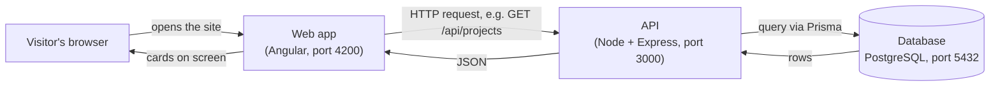

# Portfolio Project — Documentation

> Last verified against the code: **2026-10-19** (chips confirmed by the owner the same day).
> Status labels used throughout: ✅ **Implemented** · 🟡 **Built, not yet confirmed at runtime** · 📝 **Planned / proposed** · ❓ **Unknown / needs verification**

## What this project is

The personal portfolio website of **Devaangini Mehta, Frontend Engineer**. It is also a deliberate *learning project*: the site is built end to end so that every layer — what you see in the browser, the server that answers requests, and the database that stores the content — is understood, not just copied.

## The three layers in one picture



- **Web app** (`web/`) — the pages and buttons. Most sections are written directly in the page; the **Projects** section fetches its content from the API.
- **API** (`api/`) — receives requests, checks them, asks the database, and sends back JSON.
- **Database** — PostgreSQL. Holds the `projects` table.

## Documentation pages

| # | Page | What it covers |
|---|------|----------------|
| 01 | [Project overview](01-project-overview.md) | What the site is, who it is for, what works today |
| 02 | [System architecture](02-system-architecture.md) | How the three layers fit together, responsibilities, errors |
| 03 | [Frontend](03-frontend-documentation.md) | Angular app: start-up, components, styles, the Projects feature |
| 04 | [API](04-api-documentation.md) | Express server, request lifecycle, full endpoint reference |
| 05 | [Database](05-database-documentation.md) | Tables, columns, migrations, Prisma, name mapping |
| 06 | [End-to-end data flow](06-end-to-end-data-flow.md) | Real features traced from click to database and back |
| 07 | [Local setup](07-local-setup-and-development.md) | Installing and running everything on a new machine |
| 08 | [Testing and debugging](08-testing-and-debugging.md) | What tests exist, how to debug a broken request |
| 09 | [Deployment and configuration](09-deployment-and-configuration.md) | Current config, and a **proposed** deployment plan |
| 10 | [Security and maintenance](10-security-and-maintenance.md) | Protections in place, risks, recommendations |
| 11 | [Glossary for beginners](11-glossary-for-beginners.md) | Every technical term, in plain English |

Diagrams: [system architecture](diagrams/system-architecture.md) · [frontend flow](diagrams/frontend-flow.md) · [API request flow](diagrams/api-request-flow.md) · [database relationships](diagrams/database-relationships.md)

## Suggested reading order

**New to programming?** 01 → 11 (glossary, keep it open) → 02 → 06 → 03 → 04 → 05.

**Developer joining the project?** 01 → 02 → 07 (get it running) → 06 → 04 → 05 → 03 → 08 → 10 → 09.

## Quick reference

```bash
# API (terminal 1)
cd api
npm install
npm run dev                 # http://localhost:3000

# Web (terminal 2)
cd web
npm install
npm start                   # http://localhost:4200

# Database tooling (in api/)
npx prisma validate         # check the schema file
npx prisma migrate dev --name <change>   # change table structure
npx prisma generate         # refresh the TypeScript client after a schema change
npx prisma studio           # browse/edit rows in the browser
```

Full details: [07 — Local setup](07-local-setup-and-development.md).

## Documentation status (what is incomplete or unverified)

| Area | Status |
|------|--------|
| Projects list, single project, title search, paging | ✅ |
| Category endpoint + category filter chips (API + web) | ✅ confirmed working in the browser (2026-10-19) |
| Experience, Skills, Contact, Footer sections | 📝 not built (header links to `#experience` and `#skills` currently go nowhere) |
| "My role" line and metrics on project cards | 📝 removed for now; to be re-added via a migration |
| Automated tests | Only Angular's default test exists, and it is **out of date** (see [08](08-testing-and-debugging.md)) |
| Deployment | 📝 not configured; [09](09-deployment-and-configuration.md) is a proposal |
| Exact current wording of project summaries in the database | ❓ |

The working context for ongoing development lives in `../SESSION_CONTEXT.txt`.
