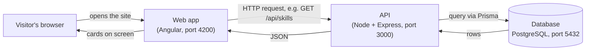

# Portfolio Project — Documentation

> Last verified against the code: **2026-10-22**.
> Status labels used throughout: ✅ **Implemented** · 🟡 **Built, not yet confirmed at runtime** · 📝 **Planned / proposed** · ❓ **Unknown / needs verification**

## What this project is

The personal portfolio website of **Devaangini Mehta, Frontend Engineer**. It is also a deliberate *learning project*: the site is built end to end so that every layer — what you see in the browser, the server that answers requests, and the database that stores the content — is understood, not just copied.

## The three layers in one picture



- **Web app** (`web/`) — the pages and buttons. **Projects, Experience and Skills** fetch their content from the API; the **Contact form** sends messages to it. The hero, numbers and "What I do" are written directly in the page.
- **API** (`api/`) — receives requests, checks them, asks the database, and sends back JSON.
- **Database** — PostgreSQL. Five tables: `projects`, `experiences`, `skill_groups`, `skills`, `messages`.

### The one mental model to keep

> Think of the database as an Excel file with sheets.
> 1. **Filling the sheets** happens separately: by hand in pgAdmin (`projects`), with the seed script (`experiences`, `skill_groups`, `skills`), or by visitors through the contact form (`messages`).
> 2. **Reading the sheets** happens on every page load: Angular → API → Prisma → PostgreSQL → back to Angular.

## Documentation pages

| # | Page | What it covers |
|---|------|----------------|
| 01 | [Project overview](01-project-overview.md) | What the site is, who it is for, what works today |
| 02 | [System architecture](02-system-architecture.md) | How the three layers fit together, responsibilities, errors |
| 03 | [Frontend](03-frontend-documentation.md) | Angular app: start-up, components, styles, animations, data features |
| 04 | [API](04-api-documentation.md) | Express server, request lifecycle, full endpoint reference |
| 05 | [Database](05-database-documentation.md) | Tables, the first relationship, migrations, seed, Prisma |
| 06 | [End-to-end data flow](06-end-to-end-data-flow.md) | Real features traced from click to database and back (reading **and** writing) |
| 07 | [Local setup](07-local-setup-and-development.md) | Installing and running everything on a new machine |
| 08 | [Testing and debugging](08-testing-and-debugging.md) | What tests exist, manual checks, debugging a broken request |
| 09 | [Deployment and configuration](09-deployment-and-configuration.md) | Current config, production scripts, and the deployment plan |
| 10 | [Security and maintenance](10-security-and-maintenance.md) | Protections in place, risks, recommendations |
| 11 | [Glossary for beginners](11-glossary-for-beginners.md) | Every technical term, in plain English |

Diagrams: [system architecture](diagrams/system-architecture.md) · [frontend flow](diagrams/frontend-flow.md) · [API request flow](diagrams/api-request-flow.md) · [database relationships](diagrams/database-relationships.md)

## Suggested reading order

**New to programming?** 01 → 11 (glossary, keep it open) → 02 → 06 → 03 → 04 → 05.

**Developer joining the project?** 01 → 02 → 07 (get it running) → 06 → 04 → 05 → 03 → 08 → 10 → 09.

## Quick reference

```bash
# API (terminal 1)
cd api
npm install
npm run dev                 # http://localhost:3000
npm run seed                # (re)fill experience + skills from CV data

# Web (terminal 2)
cd web
npm install
npm start                   # http://localhost:4200
npm test                    # unit tests (Vitest)

# Database tooling (in api/)
npx prisma migrate dev --name <change>   # change table structure
npx prisma generate         # ALWAYS run after a structure change (Prisma 7)
npx prisma studio           # browse/edit rows in the browser

# Production-style run of the API (in api/)
npm run build && npm run start:local
```

Full details: [07 — Local setup](07-local-setup-and-development.md).

## Documentation status (what is incomplete or unverified)

| Area | Status |
|------|--------|
| Projects list, single project, title search, paging, category chips | ✅ |
| Experience and Skills from the database (+ seed script) | ✅ confirmed by the owner |
| Contact form saving to the database (`POST /api/contact`) | ✅ confirmed by the owner (Postman + form) |
| "Light & Calm" redesign, animations, headshot | ✅ applied; latest animation set + code-style favicon 🟡 not yet confirmed |
| API production scripts (`build`, `start`) | 🟡 built and checked by Claude; not yet run by the owner on Windows |
| "My role" line and metrics on project cards | 📝 postponed |
| Email notification for new messages | 📝 planned at deployment (Resend free tier) |
| Deployment | 📝 not done; [09](09-deployment-and-configuration.md) has the plan |
| Projects in the seed script | 📝 projects rows exist only in the local database |

The working context for ongoing development lives in `../SESSION_CONTEXT.txt`.
