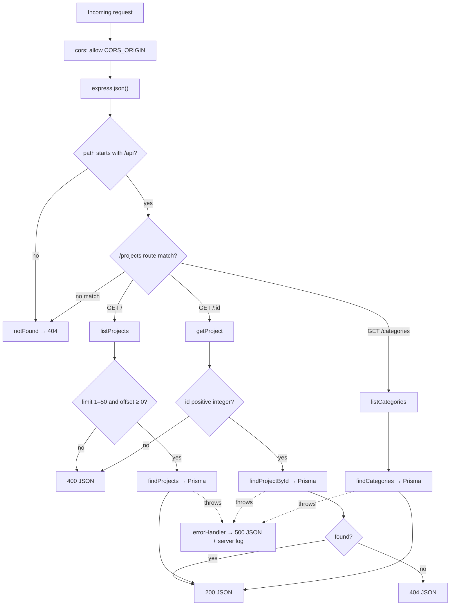

# Diagram — API Request Flow

[← Docs home](../README.md) · Explained in [04 — API](../04-api-documentation.md)

Middleware runs first, then the route. Controllers return 400/404 for bad input or missing items. Anything that throws ends in the error handler.
