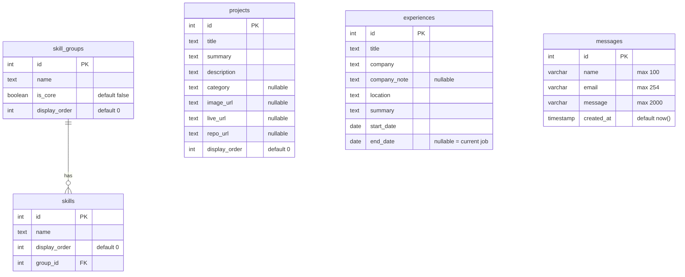
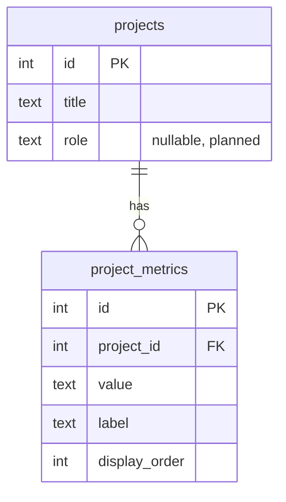

# Diagram — Database Relationships

[← Docs home](../README.md) · Explained in [05 — Database](../05-database-documentation.md)

## Current (implemented)

One relationship so far: **one skill group has many skills**. `skills.group_id` points at `skill_groups.id`; deleting a group deletes its skills (`ON DELETE CASCADE`). The other tables stand alone. `_prisma_migrations` (managed by Prisma) is omitted.

## 📝 Possible next (postponed)

One project would have many metrics (e.g. "69M+ transactions"), using the same pattern as skill groups and skills.
