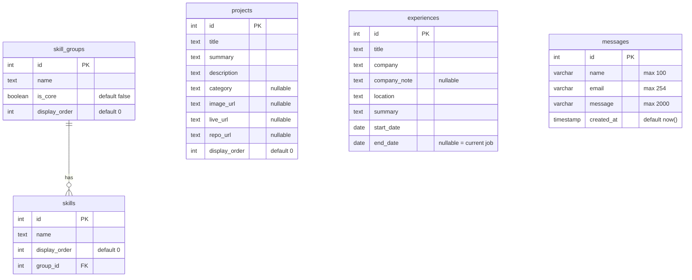
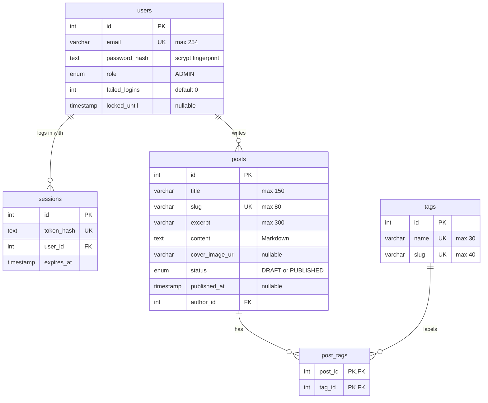
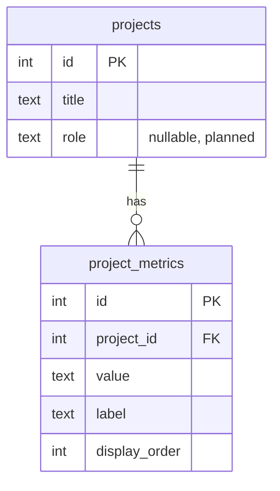

# Diagram — Database Relationships

[← Docs home](../README.md) · Explained in [05 — Database](../05-database-documentation.md)

## Current (implemented)

Portfolio: **one skill group has many skills**. `skills.group_id` points at `skill_groups.id`; deleting a group deletes its skills (`ON DELETE CASCADE`). The other portfolio tables stand alone. `_prisma_migrations` (managed by Prisma) is omitted.

## Blog tables (Blog milestone 2, implemented)

- One user (me) has many **sessions** (logged-in browsers) and writes many **posts**.
- **Many-to-many:** posts ↔ tags, through the join table `post_tags` (one row per pair; the pair is the key).
- Deleting a user deletes their sessions; deleting a post or tag deletes its `post_tags` rows (cascade).

## 📝 Possible next (postponed)

One project would have many metrics (e.g. "69M+ transactions"), using the same pattern as skill groups and skills.
