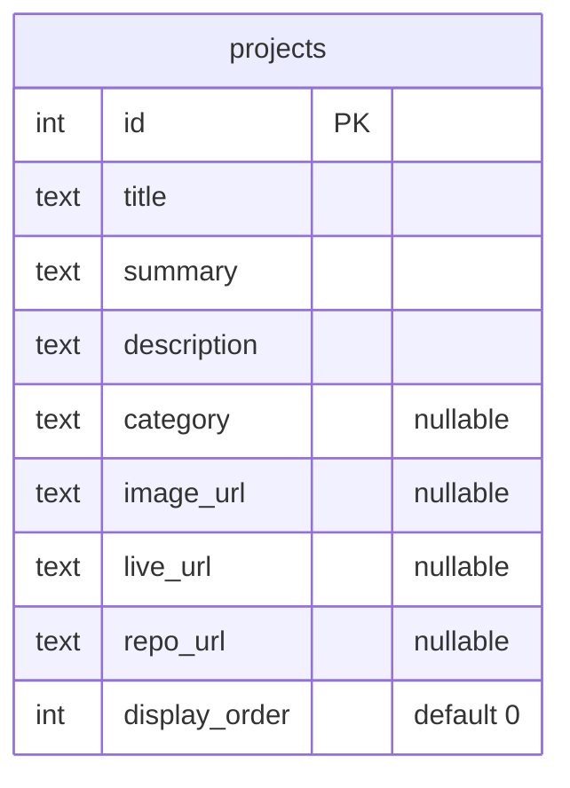
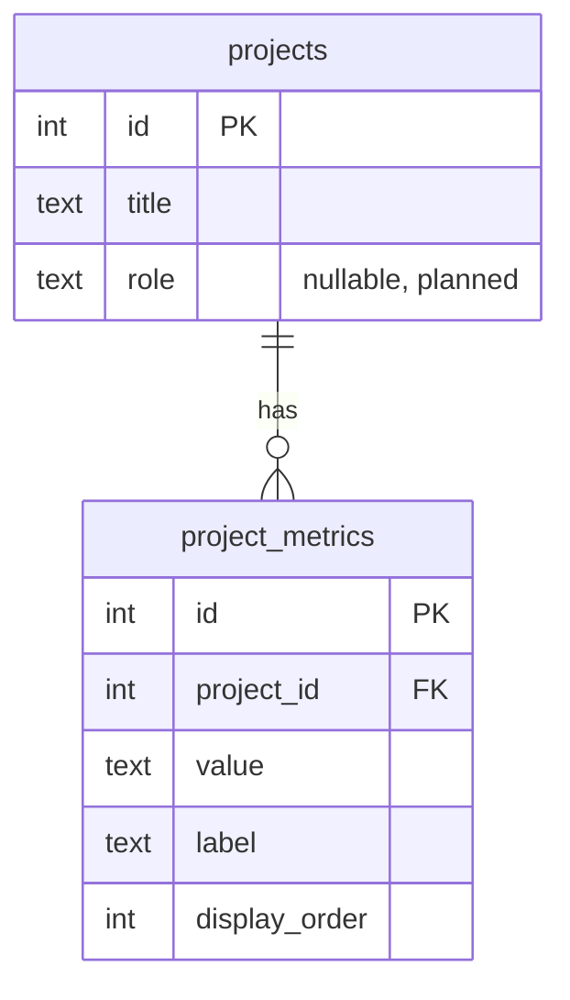

# Diagram — Database Relationships

[← Docs home](../README.md) · Explained in [05 — Database](../05-database-documentation.md)

## Current (implemented)

One table, no relationships. `_prisma_migrations` (managed by Prisma) is omitted.

## 📝 Proposed next (not implemented)

One project has many metrics (e.g. "69M+ transactions"). `project_metrics.project_id` would point at `projects.id`, with deletes cascading.
