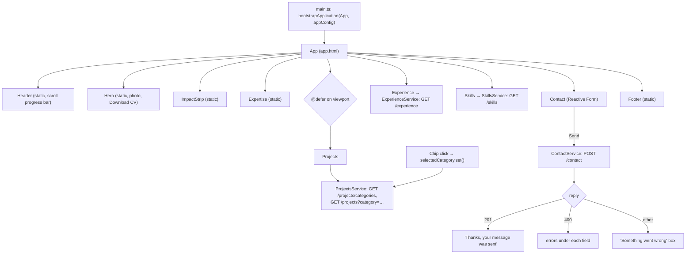

# Diagram — Frontend Flow

[← Docs home](../README.md) · Explained in [03 — Frontend](../03-frontend-documentation.md)

Static sections render immediately. Experience and Skills fetch as soon as the page is created; Projects loads when scrolled near. The contact form sends data only when the visitor clicks **Send message**.
