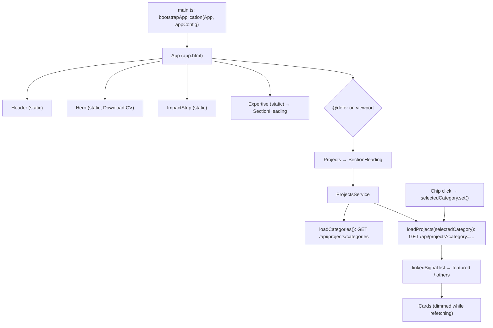

# Diagram — Frontend Flow

[← Docs home](../README.md) · Explained in [03 — Frontend](../03-frontend-documentation.md)

Static sections render immediately. The Projects section loads when scrolled near, then fetches categories and projects. A chip click changes a signal, which re-runs the projects request automatically.
