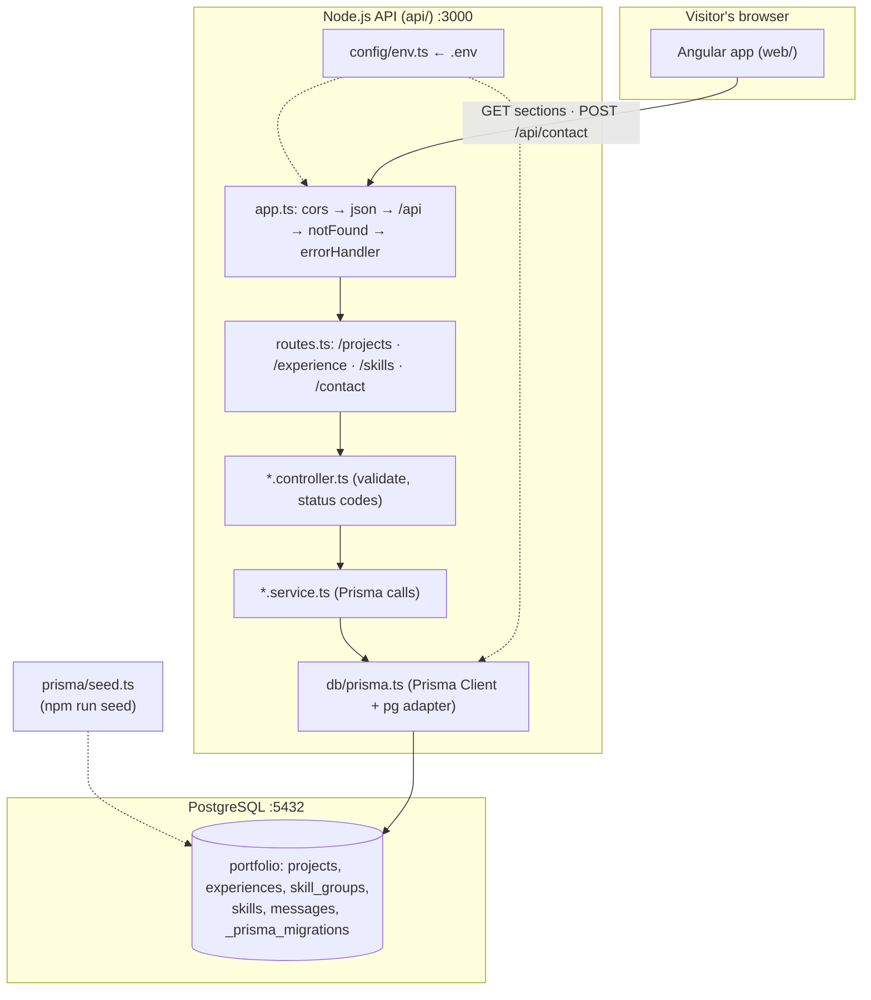

# Diagram — System Architecture

[← Docs home](../README.md) · Explained in [02 — System architecture](../02-system-architecture.md)

The browser talks only to Express; only Prisma (inside services) talks to PostgreSQL. `.env` settings enter through `config/env.ts`. The seed script is run by hand, not by the website.
